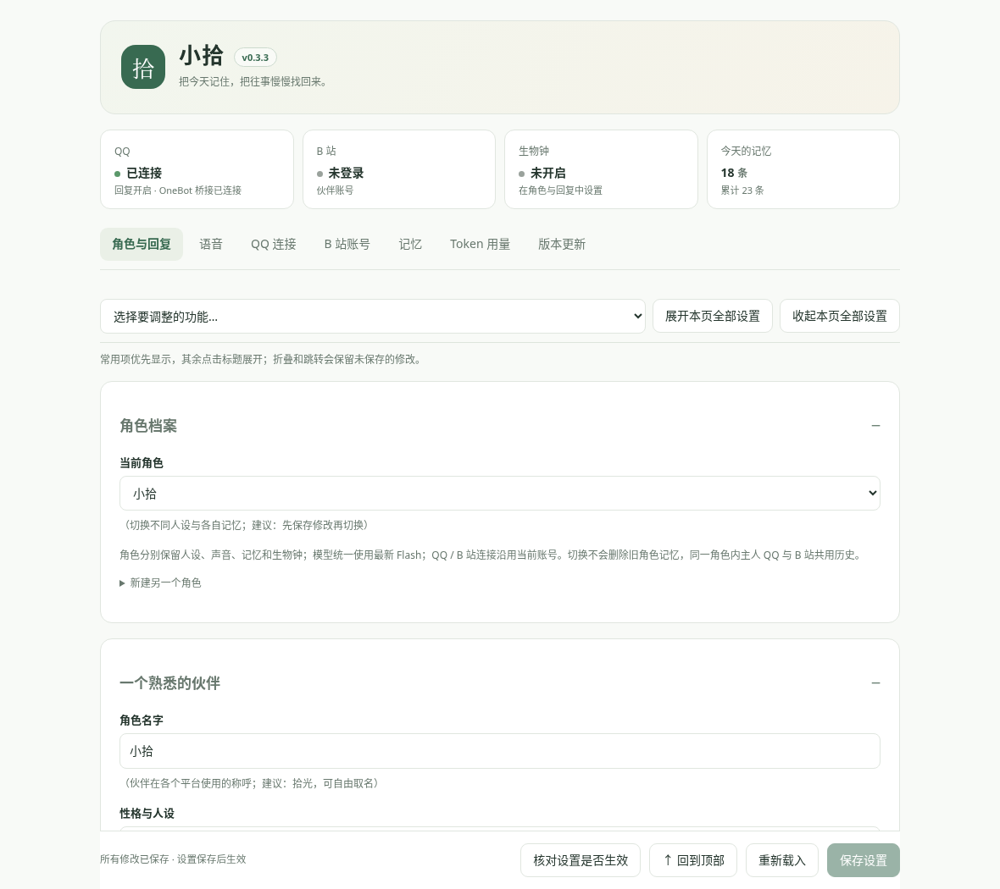
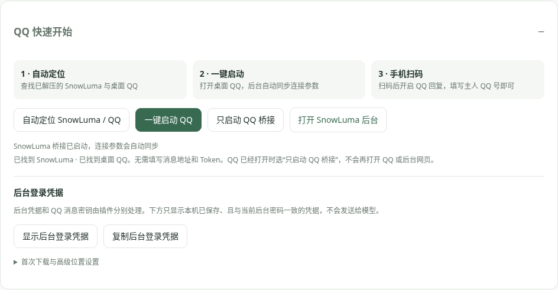
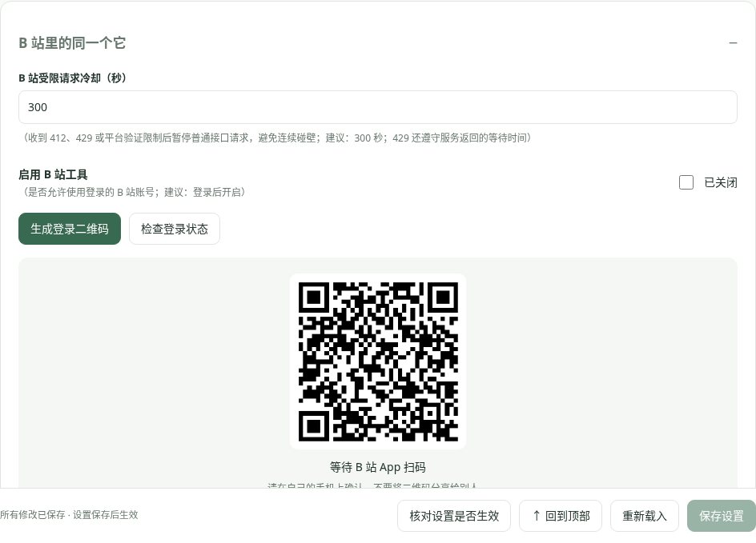
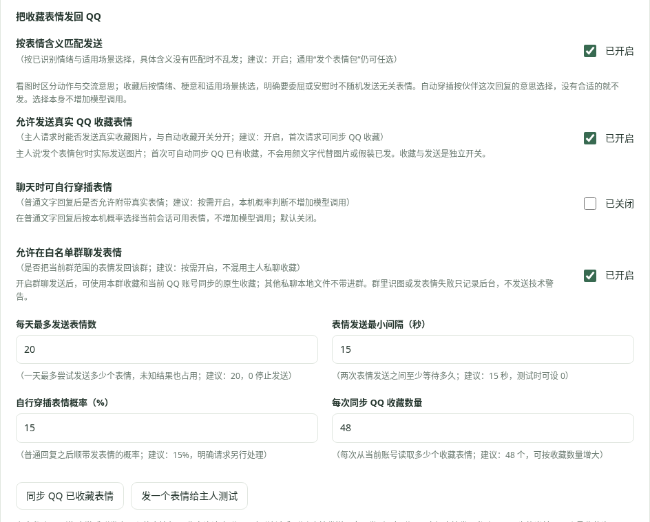
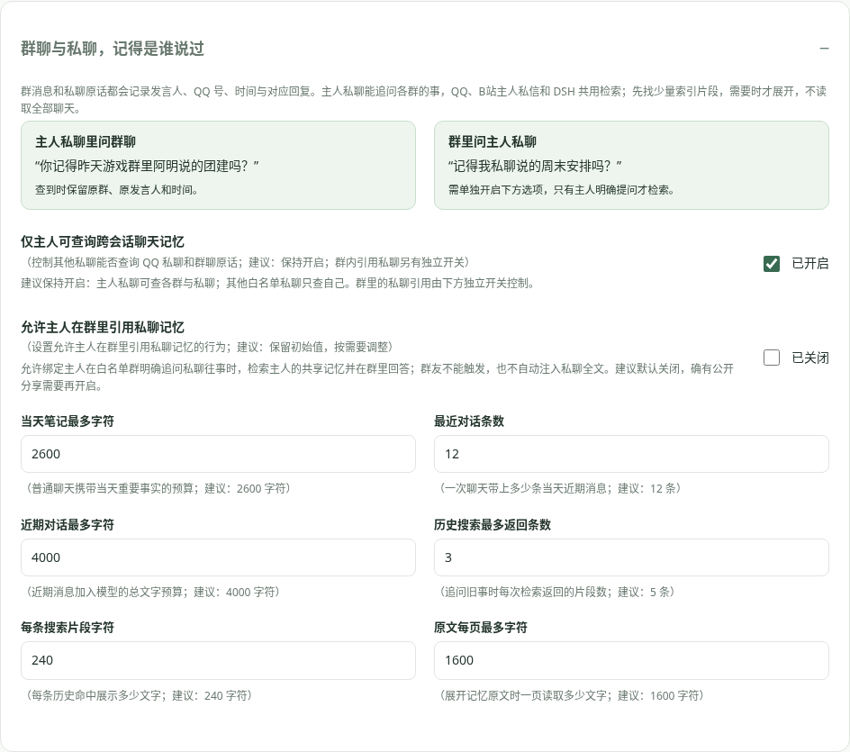
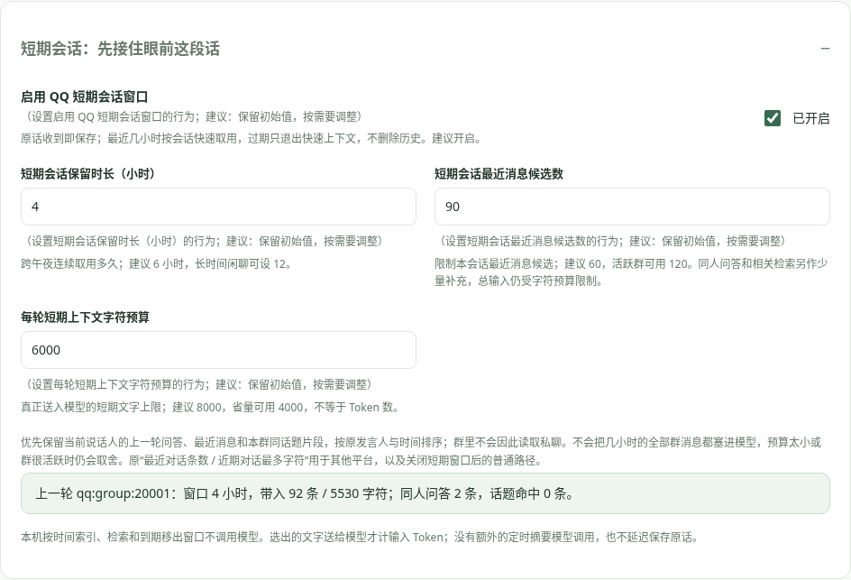
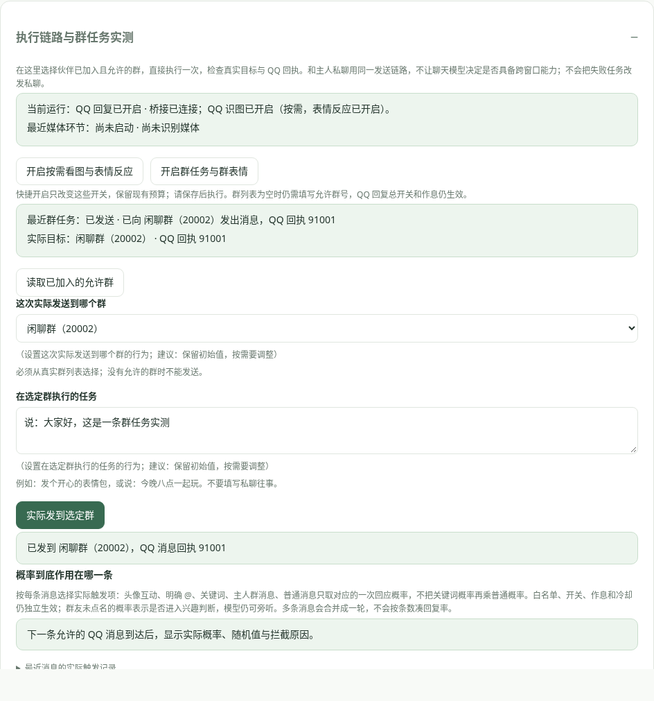
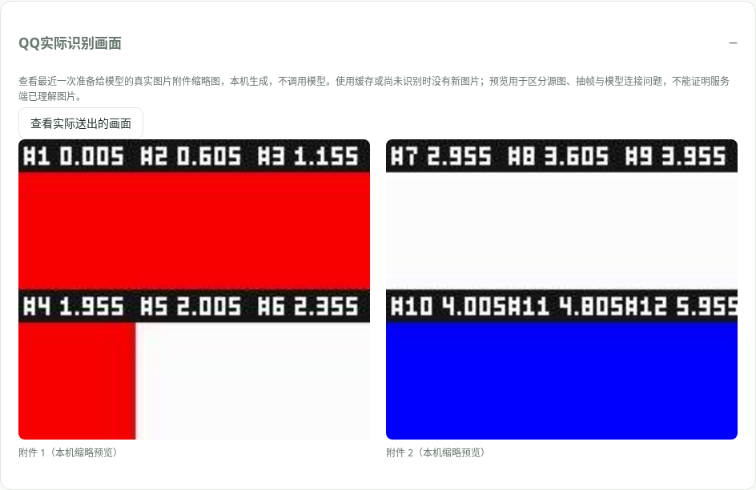
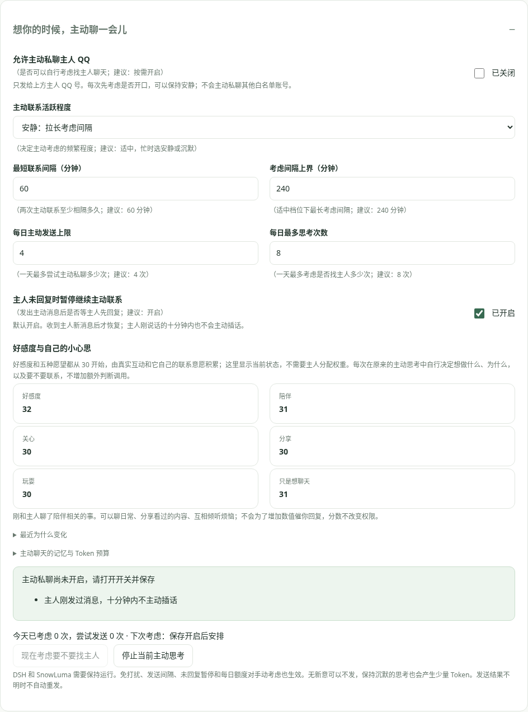

# 拾光

**在 QQ 聊天、一起刷 B 站，还记得和谁经历过什么的 AI 伙伴。**

[下载安装](https://github.com/Lyuu508/dsh-shiguang/releases/tag/v0.3.3) · [图文入门](#从安装到扫码登录) · [功能一览](#它能做什么) · [使用指南](docs/guide.md)

拾光是面向 Windows 的独立 **DeepSeek Harness 插件**。通过 SnowLuma 连接个人 QQ，用伙伴账号登录 B 站；名字、人设、作息与开关都在 DSH 设置中调整，聊天和识图统一使用 DSH 的最新 DeepSeek Flash。

下方截图使用演示数据；设置可按标题折叠，也可用顶部导航直接找到功能。

## 从安装到扫码登录

### 1 · 把这句话发给 DSH

> 帮我安装 GitHub 仓库 **Lyuu508/dsh-shiguang** 的拾光插件：使用最新正式 Release 链接的 `downloads` 中的预构建 TGZ，核对 SHA256 后安装到当前 DSH profile，保留已有配置和记忆，完成后提醒我重启 DSH。

完成后 **重启 DSH → 刷新页面 → 设置 → 拾光**。先在 DSH 登录 DeepSeek 或配置官方 API，插件无需再填写模型提供方和模型名。已安装的用户可在 **版本更新 → 检查更新 → 下载并安装更新** 升级。[备用安装与超时处理](docs/guide.md)

### 2 · 连接 QQ，手机扫码登录

1. 安装腾讯官方 **Windows 桌面 QQ（NTQQ）**。
2. 从 QQ 页的下载链接或 [SnowLuma 官方 Release](https://github.com/SnowLuma/SnowLuma/releases) 下载 Windows 完整 ZIP，右键 **全部解压** 到固定目录，不要在压缩包中启动。
3. 打开 **QQ 连接 → 连接你的 QQ 伙伴**，填 **主人 QQ 号**并保存。这是找伙伴说话的号，伙伴登录另一个 QQ 号。
4. 点 **一键启动 QQ**，在打开的桌面 QQ 原生窗口用手机扫码。已有 QQ 在运行时可选 **只启动 QQ 桥接**；找不到程序时点 **自动定位 SnowLuma / QQ**，特殊路径可在高级选项填写。
5. 头部显示连接成功后，点 **检测已保存的连接**，开启 **启用 QQ 回复**并保存，再从主人号发消息。测试时可以把回应概率临时设为 100%。

**不需要手填 OneBot 地址或 Token。** 拾光自动读取本机配置并保持鉴权。点 **打开 SnowLuma 后台**进入管理网页；需要后台密码时，点 **显示后台登录凭据 / 复制后台登录凭据**再粘贴，已自行修改的密码不会被覆盖。

SnowLuma 按 [EULA §5.4](https://github.com/SnowLuma/SnowLuma/blob/main/EULA.md) 由你下载并解压，拾光负责后续定位、启动与连接，不捆绑其专有组件。[完整 QQ 指南](docs/snowluma.md)

### 3 · 登录 B 站伙伴账号

1. 打开 **B 站账号**，开启 **启用 B 站工具**并保存。
2. 点 **生成登录二维码**，用伙伴账号的手机 **B 站 App** 扫码并确认，再点 **检查登录状态**核对。
3. 按需开启 **允许发表评论 / 允许给视频点赞 / 视频内容识别**，保存后在主人 QQ 私聊安排任务。
4. 要接收你的 B 站私信，填 **主人 B 站 UID 白名单**，开启私信回复。首次检查建立边界后，用主人账号发送一条新消息。

二维码截图为测试演示，登录时使用自己后台新生成的二维码。Cookie 保存在本机，无需手动提供。**412** 表示平台拒绝请求或要求验证：先在官方 App 检查伙伴账号，按提示处理后稍后重试。[B 站受限说明](docs/bili-risk.md) · [主人私信与评论 @](docs/social.md)

### 4 · 让它在群里聊天、发表情

在 **QQ 连接 → 允许哪些人找它聊天** 填群号。想未被点名也接话，开启 **允许自主接上群里的话**；主人群概率独立设置，明确 @ 默认独立 100%，睡眠仍遵循生物钟。

真正发表情需要：

1. 在 **收藏喜欢的表情，也真的发出去** 点 **同步 QQ 已收藏表情**。
2. 开启 **允许发送真实 QQ 收藏表情**和 **允许在白名单群聊发表情**，保存。
3. 私聊安排群任务时，再开启 **允许主人私聊下达群任务**。多个允许群请说清群名或群号。

| 在哪里说 | 可以这样试 |
|---|---|
| 主人私聊 | `去游戏群发个开心的表情包` |
| 主人私聊 | `去 12345 群说：今晚八点一起玩` |
| 允许群内 @ 伙伴 | `发个委屈的表情包` |
| 主人私聊 | `去刷一下 B站，回来分享你觉得有趣的视频` |

群表情发到指定群，私聊只确认结果。只有 QQ 返回消息 ID 才记录成功；没有匹配含义时不随便发。群内可用本群收藏及当前 QQ 账号已同步的原生收藏；其他账号和其他私聊本地文件不因此共享。

旧收藏还没有含义？在 **QQ 连接 → 让它自己整理旧收藏 → 开始补齐旧收藏**，建议每天 20 次、间隔 3 秒。整理原图 / 动图的意思和场景会产生模型用量，可以暂停、纠正或重试。[表情收藏与含义](docs/clock-emoji.md)

群聊文字回复还可在 **听完这一轮，再慢慢回 → 群聊引用回复方式** 选择自动、始终或关闭。多人合并时引用实际回应的那条消息；分气泡只在首段引用。你引用群友原话提问时，也会核对同群来源后读取原话。[引用回复](docs/qq-conversation.md#群聊引用回复)

### 5 · 查看与互通群聊、私聊记忆

**记忆** 页可点 **QQ 私聊记忆 / QQ 群聊记忆** 快捷筛选，再选择某个群、日期或关键词。一次交流合成一张卡，显示 **谁说的原话、它的回复、各自时分秒**。

- **主人私聊问群里的事**：例如 `你记得昨天游戏群里阿橙提议了什么吗？`，按索引检索对应群，保留原发言人，不把群友的话记成主人说的。
- **群里问私聊往事**：默认关闭。需要时在记忆页开启 **允许主人在群里引用私聊记忆**；之后只有绑定主人在允许群明确追问私聊内容才会检索，回答会在该群公开。
- **其他人私聊**：保持 **仅主人可查询跨会话聊天记忆**开启，他们只查自己的记录。群友不会因主人开启群内引用而获得私聊权限。

QQ 默认开启 **短期会话窗口**：最近 6 小时、60 条近期候选、每轮最多 8000 字符；优先接住当前群友上一轮问答与同话题片段，跨零点连续。原话收到就保存，过期只是退出快速上下文，不删除历史。可在记忆页调整小时数与预算。

**本机查缓存不消耗模型 Token；选出的聊天内容送入模型会计输入 Token。** 不把几小时全部群聊塞给模型，也不另开定时摘要调用。明确追问往事再查历史索引，并按 ID 展开少量原文。不会每次把所有聊天重读。支持“今天 / 全部”下载，以及 JSON、JSONL、TXT、Markdown 导入；普通琐事可淡忘，重要知识可永久保存。[记忆与外部卡说明](docs/memory.md)

## 看图与群任务，先确认实际执行

在 **QQ连接 → 执行链路与群任务实测** 查看正在运行的开关，可快捷开启识图或群任务，再保存。读取已加入的允许群，选择目标并实际发送；收到群号和 QQ 回执才算完成。主人私聊可直接安排，不用先让模型判断能不能跨窗口。

**QQ实际识别画面** 可预览准备给模型的附件，不产生模型调用。若本机预览正常、模型仍说空白，请运行图片自检核对当前 Flash 连接；不会把失败结果当作看过，也不自动重复收费请求。[图片、表情反应与诊断](docs/qq-media.md)

在 **QQ连接 → 想你的时候，主动聊一会儿** 查看好感度与五种愿望。只读展示当前数值和变化原因；可设置联系的活跃程度、间隔和额度，由它决定每次为什么想找你。[好感度与主动分享](docs/social.md)

## 在 B 站评论区继续接话

**主人安排回复**：开启 B 站工具、登录伙伴账号并允许发表评论，在“评论区里，也能接着聊”贴视频链接，点 **读取视频评论 → 回复这条评论 → 填文字 → 发送到选定评论下**。可展开某层的回复再选目标。也可以在主人 QQ / B站私聊让它先读取评论，再回复指定作者的那条。

**自动接话**：打开 **自动接住别人对伙伴评论的回复**，选择仅主人或“所有直接回复伙伴评论的人”，保存。首次只建立边界，之后接新回复；核实确实回复了伙伴的评论才处理，可以选择安静，真实回复后显示评论 ID。遵循作息、判断额度和账号评论总额度，不读取私聊。

[评论区图文教程与自动接话设置](docs/comments.md)

## 它能做什么

| 功能 | 已实现的能力 | 设置 / 教程 |
|---|---|---|
| QQ 陪伴 | 私聊与群聊、@ / 关键词 / 双击头像回应、主人称呼、概率与延迟、连续消息合并、分气泡发送 | [回复节奏](docs/qq-conversation.md) |
| 图片、动图与视频 | 静态图直传，动图按动作顺序分图，视频抽样关键帧；内置解码引擎，无需本机 FFmpeg | [识图与自检](docs/qq-media.md) |
| 收藏与发送表情 | 理解情绪与场景、自动补齐旧收藏、人工纠正、群内发原图 / GIF、私聊要求直接分流到目标群发送，无需模型判断是否能跨窗口 | [收藏与含义](docs/clock-emoji.md) |
| 群与私聊记忆 | 记录说话人和对应回复、主人按权限互通、小时窗口连续接话 / 历史检索、下载与外部卡导入 | [记忆管理](docs/memory.md) |
| 学梗与黑话 | 向主人或允许群友学习词义、记录解释者和原群，按索引快速回想 | [词库](docs/memory.md#梗与黑话) |
| B 站互动 | 扫码登录、视频介绍与内容识别、读取真实楼层、指定回复、回复通知自动接话、点赞与动态、主人私信与评论 @ 任务 | [B 站互动](docs/social.md) |
| 自主刷视频 | 按标签 1–10 权重和白黑名单选择、偏好热门、浅看 / 分段深看、随手短评、评论 @ 主人推荐 | [自主生活](docs/autonomy.md) |
| 主动陪伴与作息 | 好感度与自主愿望、互相分享日常烦恼；固定或自由醒来、统一起床睡觉、被叫醒概率、五种主动私聊动机与活跃程度 | [主动私聊](docs/social.md) · [生物钟](docs/clock-emoji.md) |
| 声音与角色 | 火山 APPID / Access Token / 音色 ID、复刻语音试听与回复；新建角色、自由切换，各自保留记忆 | [语音](docs/voice.md) · [角色设置](docs/settings.md) |
| 用量与更新 | 按实际服务回执统计 Token、整个本机 DSH 与当前角色分开看、导出与对账；检查更新、校验安装包 | [Token 统计](docs/token-usage.md) · [版本更新](docs/updates.md) |

自主接话、主动私聊、B 站评论和视频识别等能力按需开启。自动浏览需要伙伴账号登录、白名单标签和相应权限；不强制每轮互动或发动态，视频识别使用抽样画面与可用字幕，暂不转写原始音频。

**Token 不等于中文字数。** 抽样帧数是上限，重复画面可能合并；增加帧数、分图或分段会增加输入。图片自检、QQ 识图和旧收藏整理的真实用量可分别查看。[预算与限制](docs/qq-media.md)

## 本次更新 · 0.3.3

- **好感度与自主愿望**：六项都从 30 开始，随真实主人交流与自己的联系选择积累；由它决定此刻为什么想陪伴、关心、分享、玩耍或聊天，后台显示变化原因，取消手动动机权重。
- **表情后接反应**：内部记住画面与含义，聊天里顺势接情绪；明确问含义才解释。支持先发图后单独追问，群友自主接话也能读取图片；“看不到 / 空白”不再缓存为成功识图，提供真实附件预览。
- **群任务直接执行**：明确的群文字与表情任务先执行再确认；支持只回群名继续待确认任务，后台可选真实群实测并查看群号与 QQ 回执。旧桥接明确不支持原生收藏接口时，可用同账号原图兼容发送。
- **B站往事接到QQ**：主人追问“刚刚 @ 的那个视频”可按索引取回已保存的原始评论、视频地址与实际回复，包括旧版记录；不把“评论过了”当作本轮对话的结束。
- **看见实际执行**：关键词只抽一次回应概率；显示每条消息的实际概率与拦截原因、B站识别阶段和附件数。明确要求看 BV 视频直接执行读取，随后仍可继续完成评论等要求。

[完整更新记录](CHANGELOG.md) · [验证记录](VALIDATION.md) · [源码与安装包](downloads/)

需要 **DSH 0.2.2-rc.1、Node.js 24.9+、Windows 桌面 QQ 与 SnowLuma**。Windows 和真实账号仍需本机联调；测试范围见验证记录。尚未实现原始音频转写、QQ 空间说说和 QQ 语音输入识别。

MIT License
