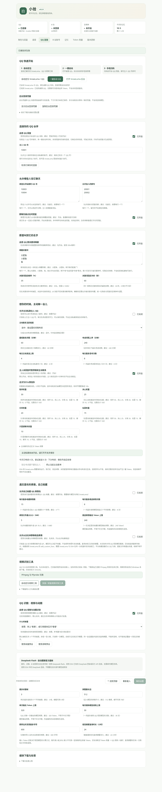

# 拾光 Shiguang

**一个在 QQ 聊天、帮你处理 B 站互动，还记得今天发生了什么的 AI 伙伴。**

[下载安装](https://github.com/Lyuu508/dsh-shiguang/releases/tag/v0.2.0) · [使用指南](docs/guide.md) · [QQ 视频与动图](docs/qq-media.md) · [更新记录](CHANGELOG.md)

拾光是独立的 DeepSeek Harness 插件，面向 Windows 本机使用。名字、人设、作息与功能开关可以在 DSH 设置里调整，模型统一使用最新 Flash，QQ 主人私聊、B 站操作与 DSH 对话共用一份记忆。

## 从安装到扫码登录

### 1. 把这句话发给 DSH 安装

> 帮我安装 GitHub 仓库 **Lyuu508/dsh-shiguang** 的拾光插件：使用最新 Release（含预览版）链接的 `downloads` 中的预构建 TGZ，核对 SHA256 后安装到当前 DSH profile，保留已有配置和记忆，完成后提醒我重启 DSH。

安装后**重启 DSH 并刷新页面 → 设置 → 拾光**。先在 DSH 登录 DeepSeek 或配置官方 API 连接；拾光的聊天、识图和自主思考统一使用最新 **DeepSeek Flash（deepseek-flash）**，无需填写模型提供方或名称。想白天活动、晚上休息，可在角色页开启生物钟，设置作息和被 @ 叫醒概率。已经安装旧版，也可以在“版本更新”中升级；旧按钮超时就重新发送上面的安装指令，[超时处理](docs/updates.md)。

### 2. 准备 QQ：下载、解压，然后一键启动

1. 安装腾讯官方 **Windows 桌面 QQ（NTQQ）**。
2. 点击 QQ 页的 **下载 SnowLuma Windows 完整版 ZIP**，或从 [官方 v2.4.2 完整版 ZIP](https://github.com/SnowLuma/SnowLuma/releases/download/v2.4.2/SnowLuma-v2.4.2-win-x64.zip) 下载。右键 **全部解压** 到固定文件夹；不要直接在压缩包里启动。[其他版本](https://github.com/SnowLuma/SnowLuma/releases)
3. 在 **设置 → 拾光 → QQ 连接** 填写**主人 QQ 号**并保存。可以先保持回复关闭，扫码后检测连接，再开启回复。
4. 点 **一键启动 QQ**。插件快速查找 SnowLuma 与桌面 QQ、准备本机鉴权连接、启动 QQ，并在后台就绪后打开管理网页。未找到时可点 **自动定位 SnowLuma / QQ**；特殊安装位置放在折叠的高级选项。
5. 在打开的**桌面 QQ 原生窗口**用手机扫码。扫码登录的是负责收发消息的伙伴号，“主人 QQ 号”是向它发消息的另一个号。等头部显示连接成功，点“检测已保存的连接”；开启回复并保存后，用主人号发一句话测试。关闭回复仍保持白名单消息归档。

**不需要填写消息地址或 OneBot Token。** 插件从本机官方配置自动同步，仍保留消息鉴权。首次后台向导、账号验证和协议确认在 SnowLuma 官方页面完成。

### 3. 后台登录凭据与视频工具

点击 **打开 SnowLuma 后台**，默认 `http://127.0.0.1:5099/`；也可在系统浏览器打开。后台要求登录时，在拾光点 **显示后台登录凭据 / 复制后台登录凭据**，粘贴到后台即可。

新数据目录通过 SnowLuma 官方引导变量生成本机强随机凭据；之前由拾光启动的 0.1.9 实例会尝试从私有启动记录取回，并验证是否仍匹配当前密码。**你已经改过的密码不会被覆盖或重置**，请使用自己设定的密码。后台凭据和消息 Token 分开保存，不发给模型或聊天对象。

想让它主动找你、自己收藏表情或识别 QQ 视频 / GIF，可在本页分别开启；群里想用称呼找它，可开启“QQ 群关键词唤醒”，默认概率 35%、同群冷却 60 秒；“鱼”也会匹配“钓鱼”，可只留完整称呼。作息和是否允许关键词打断睡眠统一在角色页设置。聊天和识图都使用 Flash，无需另外选视觉模型。

视频工具缺失时，先点 **自动定位视频工具**；已有 FFmpeg / FFprobe 会自动应用路径。找不到再点 **安装 / 修复视频识别工具**。已修复上游仓库迁移导致的 `fetch failed`，支持重试、备用版本清单、Windows 系统下载和断点续传；仍核对官方 SHA256。下载完成后还会分别进行校验、解压与启动检测。已安装但首次检测慢时会保留工具并提示重检，点自动定位即可，无需重下。下载失败区域也提供官方 ZIP 备用入口，手动解压后再定位。

SnowLuma 按 [EULA §5.4](https://github.com/SnowLuma/SnowLuma/blob/main/EULA.md) 由你下载并解压，拾光不捆绑其专有组件或自动代装。之后的定位、启动、取回凭据和消息连接可在插件内完成。[完整 QQ 指南](docs/snowluma.md)

### 4. 在拾光里登录 B 站

1. 打开 **设置 → 拾光 → B 站账号**，开启“启用 B 站工具”并保存。
2. 点击 **生成登录二维码**，用要交给插件使用的那个账号，在手机 **B 站 App** 中扫码并确认。
3. 页面显示登录成功后，点“检查登录状态”确认账号。登录凭据保存在本机，不需要手动导出 Cookie。
4. 要让它在视频评论区留言，开启 **允许发表评论** 并保存。然后在主人 QQ 私聊里说：`在这个 B 站视频的评论区留言：介绍得很清楚。视频链接是……`。
5. 想让它理解视频内部内容，在本页开启 **视频内容识别** ，随后说 `看看这个视频里的内容：视频链接`。使用关键帧与可用字幕，缺少 FFmpeg 时可在本页安装；[视频识别说明](docs/bili-video.md)。

想让它回复你的 B 站私信，在“主人 B 站 UID 白名单”填写你个人主页里的数字 UID，开启私信回复并保存。首次检查只建立边界，之后请从主人账号发送**新文字私信**测试；QQ 与 B 站共享记忆。[主人私信与 @ 推荐](docs/social.md)

手动指定的视频默认不要求命中自动浏览白名单，黑名单仍优先；如果要严格筛选，可开启“手动读取也要求白名单”。开启点赞权限后，也能在主人私聊里明确要求给视频点赞。

在 **从主人最近观看中发现兴趣** 单独扫码登录你自己的账号，读取最近观看视频的真实标签，勾选感兴趣的主题加入白名单并保存。主人凭据与伙伴账号分开，只用来读取兴趣；不拿主人的账号评论或点赞。

### 5. 配置自主浏览与动态（可选）

在 **B 站账号 → 自主生活** 填标签白名单和黑名单，例如白名单“科技、科普”，黑名单“广告”。标签支持拖动排序，权重滑块 **1–10**，推荐先设 5，权重高的主题更常被选中。它会核对真实标签，**黑名单优先**；自动浏览至少命中一个白名单标签才允许继续。

开启自主生活，选择固定时刻（默认 `09:00 / 15:00 / 21:00`）或**自由醒来**。自由模式不依赖固定钟点，本轮根据意愿安排下次考虑的间隔，并遵守角色页的统一生物钟与每日上限。按需要分别打开自主评论、文字动态权限和自主发动态开关，保存后可以点“现在浏览一次”。每次先决定想看哪些视频，可以跳过、浅看，或在允许后分段深看整个分 P 的时间线。它也可以决定不发布。下方状态列出未行动原因和实际互动权限；自动评论必须同时开启“允许发表评论”和“浏览时可自主评论”。填好主人 UID 并开启“发现有趣视频时在评论 @ 主人推荐”后，实际识别过的视频才可被推荐；推荐与普通评论共用额度。

想把今天 QQ 的重要笔记也作为动态灵感，再打开对应开关。默认不读取私聊原文、不向公开动态提供 QQ 笔记。默认浏览标题、简介与标签；需要画面和字幕时另外开启“自主浏览时也识别视频内容”。不转写原始音频。DSH 必须保持运行，插件不能唤醒关机或休眠的电脑。[详细设置](docs/autonomy.md)

### 6. 下载或导入记忆

在 **记忆** 页面按日期打开文件夹，一次提问与对应回复默认合在一张卡片，显示说话人、原话、回答与各自时分秒；可切回原始记录逐条查看。可筛选 QQ 私信 / 群聊，或 B 站观看 / 留言 / 点赞，查看具体视频和留言内容。切换“今天的记忆 / 全部记忆”，点击相应下载按钮保存到本地；选择本地 JSON、TXT 或 Markdown 文件，再选择导入“今天”还是“全部 / 历史”。

主人 QQ 与 B 站私信共用限量的当天近期原话。默认开启“仅主人可查询跨会话聊天记忆”：主人在私聊可追问群聊，其他白名单私聊只能查自己的记录；QQ群始终只用本群。过零点后，昨天自动变成历史，不会重复搬一遍。提问旧事时先查全文索引，最多返回少量短片段，需要时才展开原文。[记忆文件与索引说明](docs/memory.md)

普通聊天约 30 天未再提起会淡忘，退出正常检索但仍可在“已淡忘”恢复；明确教导、重要笔记和经常问到的知识会提高权重长期保留。可以手动永久记住记录，也可调整词库权重。[保留与淡忘规则](docs/memory.md)

### 7. 配置火山复刻语音（可选）

打开 **语音** 页面，填写火山语音服务的 **APPID、Access Token（Access Key）、复刻音色 ID**，先保存密钥，再开启语音并保存设置。点击“生成试听”播放；在 QQ 里说“用语音回复我”。需要预先在火山控制台完成音色复刻，也支持新版 API Key。[语音配置与计费说明](docs/voice.md)

### 8. 新建或切换角色

在 **角色与回复 → 角色档案** 新建角色，填写名字和人设，可选择复制当前声音与作息设置。不同角色的记忆独立保存，切换不会删除旧记忆；QQ / B 站连接沿用当前账号。同一角色内主人的 QQ、B 站和 DSH 对话共享记忆。先保存修改，再切换角色。

## 它能做什么

| 功能 | 已实现的能力 |
|---|---|
| QQ 聊天 | 启动本机 SnowLuma，打开桌面 QQ 扫码与后台；连接与回复独立，白名单归档；群聊支持 @ 或概率关键词点名 |
| 生物钟 | 设置起床与睡觉时间，睡眠期间暂停自动活动，被真实 @ 或配置称呼时可按概率临时醒来 |
| QQ 表情收藏 | 自己挑选喜欢的表情加入当前 QQ 收藏，设置每日收藏 / 挑选额度，重复文件去重 |
| QQ 视频与动图 | 识别短视频、GIF 和图片的主要画面；支持附文字或引用媒体提问，可随时关闭 |
| B 站视频识别 | 浅看少量关键帧，或分段覆盖整个分 P 的时间范围；结合可用字幕，缓存摘要 |
| 复刻语音 | 火山 APPID / Access Token / 音色 ID 配置、试听、QQ 按需或自动语音回复，字符与次数单独统计 |
| B 站互动 | 手机扫码登录，核验标签白黑名单，读取视频介绍，发表评论、回复评论、点赞和文字动态 |
| 自主生活 | 固定时刻或自由醒来，自己选择略过 / 浅看 / 深看白名单视频，决定是否评论、@ 主人推荐或发动态 |
| 主动陪伴 | QQ 主动私聊主人，五种动机权重、四档活跃程度、统一作息、每日额度与未回复暂停，展示等待原因 |
| B 站主人私信 | 主人 UID 白名单、回复新文字私信、共享记忆，重启后按消息序号去重 |
| 共享记忆 | 主人 QQ / B 站近期原话互通，按权限检索私聊与群聊，默认主人专属跨会话查询 |
| 角色档案 | 新建、自由切换；各自人设、声音、作息与记忆；当前版本、连接及生物钟状态清楚展示 |
| 主人兴趣 | 独立扫码读取主人最近观看标签，选择加入白名单，拖动排序及 1–10 权重 |
| 记忆淡忘 | 重要知识长期保留，普通聊天约一月未提起淡出，词库权重与永久记忆可调整 |
| 记忆管理 | 问答合并、说话人及秒级时间，按日文件夹，QQ 私信 / 群聊、B 站观看 / 留言 / 点赞筛选；下载、导入、检索与撤销 |
| 用量统计 | 按天查看 QQ 聊天、QQ 媒体、B 站任务和 DSH 对话的真实 Token 用量，支持导出 |
| 版本更新 | 后台检查 / 下载、重试与取消、备用版本清单、可调等待时间和包加速，校验后交给 DSH 安装 |

主动私聊、B 站主人私信、@ 推荐、视频识别、复刻语音和 B 站评论默认关闭，按需开启。视频理解使用抽样画面，B 站可附节选字幕，暂不转写原始音频。

## 本次更新 · 0.2.0

- **连接检测独立于回复开关**：关闭 QQ 回复也能连接、检测在线状态并保存白名单原话，不调用模型回复。
- **群聊关键词唤醒**：支持“大肥鱼、小肥鱼、鱼”等称呼，自定义概率、冷却与睡眠叫醒权限。
- **记忆保留完整问答**：谁说了什么、它回了什么放进同一张卡片，保留说话人和秒级时间；QQ / B 站主人私聊共享有预算的近期原话。
- **主人专属跨会话查询**：默认只有主人私聊与本机 DSH 能查询其他私聊 / 群聊；QQ群始终只使用本群资料。
- **修复工具安装误报**：下载、校验、解压与启动检测分阶段；首次检测慢会重试，已安装的程序保留，不因检测超时重新下载。
- **主动功能有迹可查**：显示未行动原因、下一次考虑时间和实际互动权限，修复 B 站自主思考残留旧模型路由。

[查看完整更新记录 →](CHANGELOG.md)

## 在 DSH 中调整

安装后重启 DSH 并刷新页面，打开 **设置 → 拾光**。

角色与回复 · 语音 · QQ 连接（含识图） · B 站账号（含自主生活） · 记忆 · Token 用量 · 版本更新

展开 QQ 识图设置预览

每个设置后都有括号用途和推荐值，详细预算建议见 [设置说明](docs/settings.md)。设置保存后生效。版本安装完成后，按提示刷新或重启 DSH；配置和记忆保留在原目录。

## 看视频，怎样尽量省 Token

默认使用按需模式：**发送媒体并附上“看看”，或引用媒体消息说“看看”。**

1. FFmpeg 在本机抽取候选画面，筛掉相近内容，最多保留 3 个关键帧。
2. 拼成一张最长边不超过 512 像素的小图，只调用一次视觉模型。
3. 返回简短回答，把客观画面摘要记入当前会话；后续聊天不重复发送视频或拼图。
4. 同一会话再次遇到相同媒体时，优先复用摘要，进行一次简短文字回答。

B 站浅看默认至多 4 帧、768 像素拼图和 1800 字符节选字幕。深看默认每 90 秒一段、最多 8 段，每段一次视觉调用，费用随段数增加；摘要命中时不再调用视觉模型。详见 [B 站视频识别](docs/bili-video.md)。

**Token 不等于中文字数**：不同模型的分词不同；输出上限限制模型生成预算，部分模型的思考也占预算。想限制回复字数，请调整“单次回复最多字数”。火山语音按自身服务规则单独计费。

本机下载、抽帧和筛选不调用模型。图像计费由 DeepSeek Flash 的服务规则决定，实际消耗可以在 **Token 用量 → QQ 视频 / 动图** 查看。需要字幕细节时可切换清晰预设，用更多 Token 换取更清楚的输入。

这是关键帧画面识别，暂不识别音频；快速动作、闪现字幕和未抽到的场景可能遗漏。[配置与使用边界 →](docs/qq-media.md)

## 环境与其他说明

需要 **DSH 0.2.2-rc.1、Node.js 24.9+**。Windows 安装官方 SnowLuma 与桌面 QQ；视频识别需要 FFmpeg / FFprobe（可自动定位，Windows x64 可在面板准备），模型统一使用 DSH 的最新 Flash。安装到登录的步骤见上方；需要手动安装时可用 [备用安装指南](docs/guide.md)。

- [安装、连接与常见问题](docs/guide.md)
- [视频与动图配置、预算和限制](docs/qq-media.md)
- [验证记录](VALIDATION.md)
- [源码与安装包](downloads/)

尚未实现：原始音频转写、QQ 空间说说、QQ 语音输入识别。Windows 与真实账号仍需本机联调；验证范围见验证记录。

MIT License · [反馈问题](https://github.com/Lyuu508/dsh-shiguang/issues)
