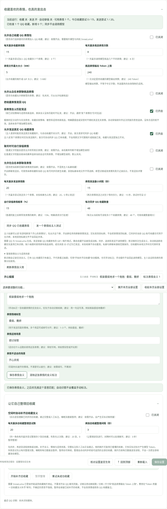
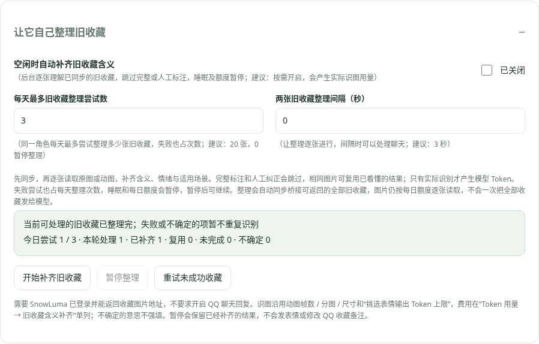
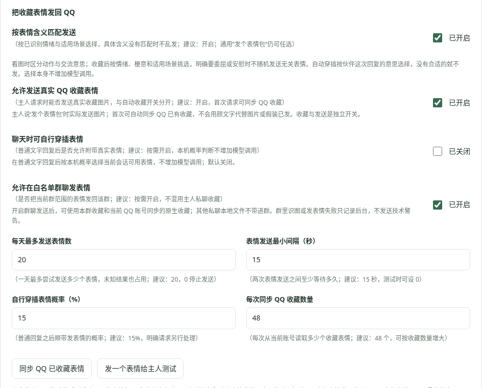

# 生物钟与 QQ 表情收藏

0.2.8 起，角色页显示当前日期和时分秒，按已保存的角色时区更新；聊天和自主思考同时收到当前时间与睡醒状态。07:30 起床即从这个时间进入清醒，夜间被叫醒另标为临时清醒。作息属于伙伴，不能据此认定主人没有睡觉；旧记录时间也不能当成现在。

## 生物钟

位置：**设置 → 拾光 → 角色与回复 → 生物钟**，默认关闭。

按角色设置中的时区安排作息，推荐每天 08:00 起床、23:00 睡觉。晚上睡眠时间可以跨午夜；起床和睡觉时间相同表示不设睡眠窗口。

睡眠期间不启动自主浏览、主动 QQ 私聊、B 站私信回复和表情挑选。允许会话的 QQ 消息仍保存到各自范围，未被叫醒时不调用聊天模型。群聊开启“仅被 @ 时回复”后，未点名消息也可只存档，不自动回复。

开启“睡眠期间允许被 @ 叫醒”后，真实 QQ `at` 消息段可以按概率叫醒，普通文字 `@名字` 不算。推荐概率 25%、临时清醒 10 分钟、两次唤醒至少相隔 30 分钟；想每次点名都醒来可设 100%，0% 表示不醒。临时清醒时间与上次叫醒时间保存在本机，重启继续生效。

临时醒来后可以回复允许会话；清醒窗口结束且仍在夜间时再次睡眠。QQ 与 B 站统一服从此处生物钟，不再另设平台休息时间。白天按起床时间恢复，不补跑错过的所有活动。

这些是插件中的行为状态，不控制 Windows 电源，也不能唤醒关闭或休眠的电脑。DSH 与 SnowLuma 需要保持运行。已经发出的平台请求仍以平台结果为准。

## 让它自己挑选表情

位置：**QQ 连接 → 收藏喜欢的表情，也真的发出去**，默认关闭。

1. 保持 QQ 连接在线，在 QQ 识图区域使用统一 Flash 与内置动图 / 视频引擎；识图总开关可独立按需使用。
2. 开启“允许自己收藏 QQ 表情包”，推荐每天最多收藏 3 个、挑选 8 次、文件 5 MB、思考输出 240 Token。
3. 默认只从允许私聊挑选；需要时另开“允许从白名单群聊挑选表情”。仅 QQ 标为表情的图片或 GIF 是候选，不把普通照片全部送去收藏。
4. 模型按人设决定是否喜欢，可以不收藏。挑选额度和收藏额度分开：拒绝收藏也会产生挑选用量，但不占收藏次数。

已在本轮识别过的媒体直接复用客观摘要，只做一次简短文字决定；没有摘要才抽一张小图调用 QQ 视觉模型。重复文件跨重启不反复挑选，模型选择安静或不收藏也会去重，避免连续扣费。真实用量见 **Token 用量 → QQ 挑选表情**。

收藏调用 SnowLuma 的实际 `add_custom_face` 接口，写入当前登录 QQ 的表情收藏，而不是只在聊天中声称“收藏了”。这个接口要求本机文件，所以 **SnowLuma 与 DSH 必须在同一台机器**，并使用支持该接口的 SnowLuma。收到 `emoji_id` 成功结果才保存成功记录；网络未知或缺回执不自动重试，已尝试仍占当天额度。

收藏容量、账号状态和接口可用性由 QQ / SnowLuma 决定。收藏原图与记录保存在本机数据目录；成功收藏会以具体时分秒出现在 QQ 时间线中。没有登录真实 QQ 账号做收藏操作，接口请求、模型选择、抽帧、去重与回执流程已使用模拟平台验证。

接口依据：[SnowLuma add_custom_face](https://snowluma.github.io/zh/docs/api/extended/add_custom_face)。

## 真正发送 QQ 收藏表情

1. 保持 QQ 与 SnowLuma 在线，开启 QQ 回复、填好主人号并保存。
2. “允许发送真实 QQ 收藏表情”默认开启；点“同步 QQ 已收藏表情”，再点“发一个表情给主人测试”。同步只读取当前登录 QQ 的收藏元数据，不下载或调用模型。
3. 主人私聊说“你发个动画表情看看”，会实际调用发送接口；首次库为空时自动同步。保留 QQ 收藏原有图片 / GIF，静态收藏不会变成动图，也不用颜文字冒充图片。
4. “聊天时可自行穿插表情”默认关闭；开启后普通文字回复结束时，按本机概率从当前范围选图，推荐 15%、每日 20 次、间隔 15 秒。同步数量推荐 48；新收藏自动挑选仍按原有视觉额度单独计费。
5. 群聊另开“允许在白名单群聊发表情”。可用本群收藏和当前 QQ 账号已同步、带原生资源 ID 的收藏；其他账号和其他私聊本地文件不会因此带进群。

上方“当前运行”显示实际收藏、发送和自动穿插开关，以及可用数和当日尝试次数；下方未保存的勾选不会冒充运行值。收到真实消息 ID 才在问答中记为已发送，未知结果占尝试额度、不自动重发。同步和发送使用 SnowLuma 2.4.2 的 fetch_custom_face_detail / send_custom_face；已保存本地原图的旧收藏可使用图片消息原样发送。

群聊识图 / 发表情失败或未开启时，不向群里发送技术警告；后台保留失败状态。私聊识图失败只作短回应，详细错误在后台查看。

## 看懂表情的意思，再按意思发送

在 **QQ连接 → 收藏喜欢的表情，也真的发出去** 开启“按表情含义匹配发送”（默认开启）。识图会在同一次调用中区分客观动作与交流含义：例如“缩成一团抬头看”是画面，“假装委屈地求安慰”是表情表达。含义不清楚时保留不确定，不猜梗的出处。

已经看懂的表情在收藏时复用摘要和含义；没有已识图结果的候选，仍使用已有的收藏挑选调用，按顺序看动作分图。发送阶段只在本机匹配已保存的情绪、含义和适用场景，不再请求一次模型。“发个委屈的表情”“来张抱抱安慰的”会寻找对应含义，没有合适的就不乱发；通用“发个表情包”仍可从当前范围任选。自动穿插以伙伴这次回复表达的意思选择，例如用户说委屈、伙伴在安慰时应选抱抱，不单凭用户的“委屈”去发哭脸。

“管理表情含义与适用场景”可以查看、补充或纠正意思、情绪标签、适用和不适用的场景。手动标注优先，自动识图不会覆盖；也能清除标注，原收藏仍保留。已同步的旧 QQ 收藏可能只有备注，没有图片理解结果；仅根据备注可用的信息匹配，不能把同步当成看懂了全部收藏。可手动标注，不产生识图费用。

发送仍需开启真实表情发送；自主穿插需单独开启，群聊另需允许发送。按当前会话范围选择；允许群聊发送后，也可用当前 QQ 账号同步的原生收藏，不共享其他私聊本地文件。原 GIF 字节不变，不会把静态图变成动图。理解和匹配受画质、模型和标签完整度影响；新分图可能增加输入 Token，以完整回执为准。完整数据目录备份包含含义标注，普通记忆 JSON 导出不包含独立收藏文件和标注。

## 让它自动整理旧收藏

升级后连接 SnowLuma / QQ，打开 **QQ连接 → 让它自己整理旧收藏**（可从顶部功能导航直达），点 **开始补齐旧收藏**。它会先同步，再读取图片，补齐意思、情绪、适用和不适用场景。已有完整含义、人工标注会跳过，同内容可复用已看懂结果；旧的自动标注缺少场景时只补缺项。

推荐 **每天最多旧收藏整理尝试数 20**、**两张间隔 3 秒**。失败也占整理尝试次数，实际收费调用与完整 Token 回执在 **Token 用量 → 旧收藏含义补齐** 单列，不把下载、缓存复用或失败次数假算成模型 Token。识图使用 QQ 动图帧数、分图数、尺寸、文件大小和“挑选表情输出 Token 上限”；动图按编号顺序读动作，不能拿备注猜意思。

一次开始可继续未完成的整理；点“暂停整理”保留已完成结果并停止后续调用，再点开始可继续。开“空闲时自动补齐旧收藏含义”后，后台约每 30 秒检查能否继续，已完成时降低检查频率；睡眠和每日额度会暂停。手动暂停后不会被后台开关立刻重新拉起。配置重载或退出会停止旧实例，重启后跳过已完成项。

自动整理会同步桥接可返回的全部收藏；“每次同步 QQ 收藏数量”只控制手动同步按钮，不限制本地按含义选图。图片仍按每日尝试额度逐张读取。接口必须提供真实可读取的图片地址，旧桥接缺失地址时会跳过并显示原因，可升级 SnowLuma 后重新同步。不确定的含义不强填；失败不会立即重复花费，可明确点击“重试未成功收藏”，仍受每日额度约束。整理不需要开启 QQ 聊天回复，也不会主动发表情、修改 QQ 收藏备注或改变收藏顺序。

## 从私聊指定群发送表情

0.3.1 起，主人私聊可以说“去游戏群发个开心的表情包”或“去 12345 群发个委屈的表情”。先允许这个群，开启“允许主人私聊下达群任务”和“允许在白名单群聊发表情”并保存，保持 QQ 在线。多个允许群请明确名字或群号。插件用原始要求挑含义，不再把群名当成表情情绪。

表情实际发到目标群，私聊只有文字反馈；取得消息 ID 后在目标群记忆里保存伙伴发言。没有匹配、关闭权限、目标不明确或回执未知都不改发私聊，也不拿颜文字 / 普通群发言冒充。已提交的同轮同群表情不会重复发送。

