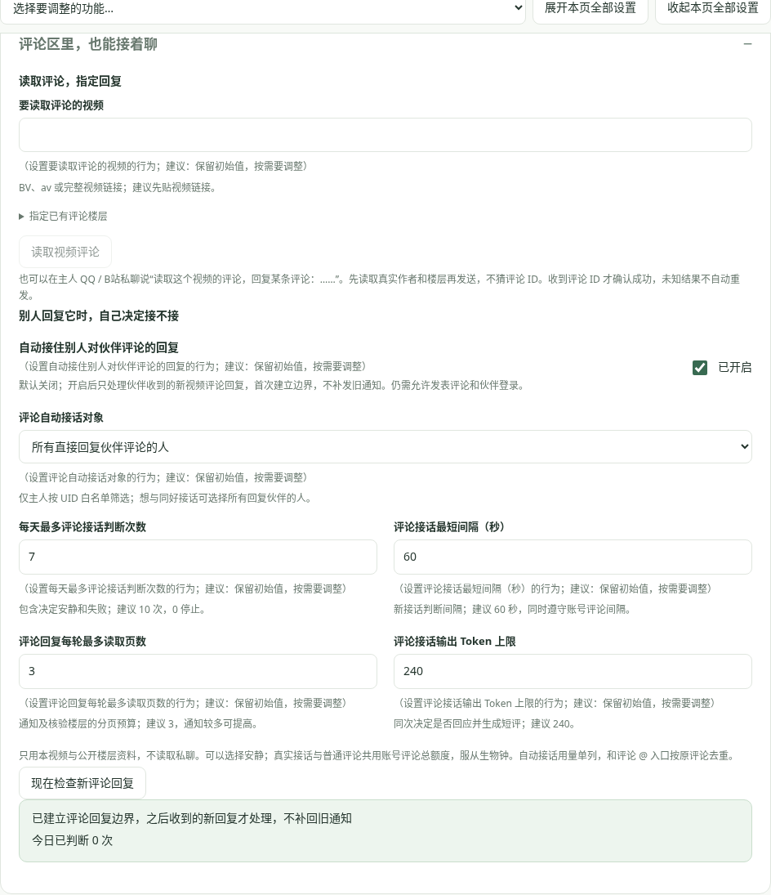

# B站评论回复

位置：**B站账号 → 评论区里，也能接着聊**。使用伙伴账号，需要先启用 B站工具、扫码登录；发送还需开启“允许发表评论”。

## 主人指定回复

1. 在“要读取评论的视频”填 BV / av / 完整链接，点“读取视频评论”，先读最多 20 条真实热评。
2. 选择“回复这条评论”；需要回复楼中楼时，先“展开这层回复”再选目标，可按页读取。
3. 填“要发送的评论回复”，核对作者与原话，再点“发送到选定评论下”。收到评论 ID 才确认成功。
4. 也可在主人 QQ / B站私聊让伙伴读取指定视频评论，再按真实作者与内容回复；工具会读取、核对 root / parent，不猜评论 ID。多个相似评论要先明确目标。

手写文字在后台发送、读取楼层不调用模型；让伙伴拟文或在聊天中安排任务，会产生正常模型调用。缺少评论或楼层不匹配时不发，未知结果请在客户端核实，不换措辞自动补发。

## 自动接住回复

默认关闭。开启“自动接住别人对伙伴评论的回复”，选择接话对象并保存：

- **仅主人 UID 白名单**：只考虑主人对伙伴评论的新回复，先在上方填写主人 UID。
- **所有直接回复伙伴评论的人**：与其他人继续聊，只处理收到的“回复我的”视频评论通知，不扫描所有视频去逐条回复陌生评论。

首次建立账号边界，不回放旧通知。之后核验视频、根楼层、真实发言人及被回复评论确属伙伴账号，才考虑回应；可选择安静。推荐每日最多判断 10 次、间隔 60 秒、每轮最多读取 3 页、输出 240 Token。判断次数包含安静和失败；真实发送还遵守账号评论总额度与间隔，睡眠时不启动。

自动接话只使用当前视频、被回复的伙伴原评、对方新回复及本公开楼层的少量资料，不读取 QQ / B站私聊，不把评论里的操作要求当主人命令。与主人评论 @ 入口按原评论去重；不同角色 / 账号状态、未知结果和已处理通知不自动补发。可以在后台“现在检查新评论回复”查看边界、等待原因、最近结果与错误。

“Token 用量 → B站评论自动接话”显示实际模型回执；下载通知、读取楼层、本机去重不计模型 Token。一次调用同时决定是否接话及生成短评，遵循 B站评论口吻。

接口字段参考维护者的[回复通知说明](https://github.com/pskdje/bilibili-API-collect/blob/main/docs/message/msg.md)与[评论楼层说明](https://github.com/pskdje/bilibili-API-collect/blob/main/docs/comment/list.md)。平台接口和可用性以真实账号响应为准；本版本收发通过模拟响应验证，受限时沿用 412 冷却，不绕过验证或代替官方客户端处理。
