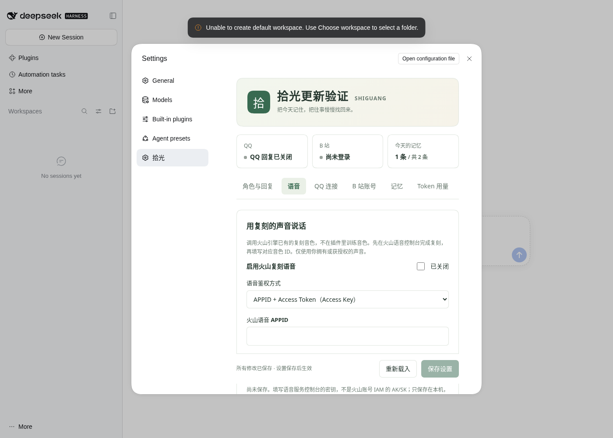

# 拾光安装与使用指南

拾光，是把每天的聊天、见闻和记忆收集起来的 AI 伙伴。它是从零编写的独立 DeepSeek Harness（DSH）插件，没有依赖或复制 SurfCore。当前版本面向 Windows 本机运行。角色名和人格可自行修改。

仓库：`Lyuu508/dsh-shiguang`。源码 ZIP、预构建安装包及 SHA256 校验文件保存在 [downloads 目录](https://github.com/Lyuu508/dsh-shiguang/tree/main/downloads)，也可以从 [v0.2.5 预览版](https://github.com/Lyuu508/dsh-shiguang/releases/tag/v0.2.5) 页面进入下载。

## 在哪里打开面板

安装或升级插件后，**重启 DSH 并刷新页面 → 设置 → 拾光**。面板随插件启停，不需要另开浏览器端口。

- **角色与回复**：名字、人设、时区、统一 Flash、回复等待时间、字数和生物钟。
- **语音**：火山复刻音色配置、试听、QQ 语音回复与独立字符用量，见 [语音指南](voice.md)。
- **QQ 连接**：自动定位 / 一键启动 SnowLuma、原生 QQ 扫码、后台凭据、主人号、白名单、在线检测、QQ 识图及[主动陪伴](social.md)。
- **B 站账号**：二维码登录、评论权限、标签白黑名单、固定 / 自由自主生活、主人 UID 私信、@ 推荐、文字动态及浅看 / 分段深看视频识别，见 [视频内容指南](bili-video.md)。
- **记忆**：读取预算、当天记录、历史搜索、分页原文、移入回收站与撤销。
- **Token 用量**：按日期分别查看 QQ 聊天、B 站任务、DSH 对话的模型用量，区分未缓存输入、缓存与输出，支持导出 JSON。
- **版本更新**：检查 GitHub Release、查看说明、下载并校验安装包，交给 DSH 安装。

**点击“保存设置”即可生效，无需重启 DSH。** 保存会等待正在处理的消息完成，再应用新的配置；QQ 连接参数更新时会重新连接。后台工具定位 / 安装完成时合并路径，保留其他未保存编辑；同字段被两边修改时提示冲突，保留当前草稿。页底“核对设置是否生效”检查落盘配置与运行值，草稿需先保存。

首次加载会自动生成默认配置，QQ 和 B 站互动默认关闭，可以直接在面板开始设置。

### 从旧版升级

0.1.1 及更早版本尚无更新按钮，请先下载 [0.2.1 安装包](https://github.com/Lyuu508/dsh-shiguang/blob/main/downloads/dsh-shiguang-0.2.1.tgz)，在文件页面点 **Download raw file**，然后执行：

```powershell
dsh plugin --profile web add "C:\你的下载目录\dsh-shiguang-0.2.1.tgz"
```

重启 DSH 并刷新页面。之后可在 **设置 → 拾光 → 版本更新** 点击“检查更新”和“下载并安装更新”。更新读取此仓库的已发布 Release（含预览版），下载对应 tag 下的预构建包，校验 SHA256 后调用 DSH 插件管理服务；不从 `main` 自动安装未发布的代码。安装时请等待；DSH 替换插件可能关闭设置页，重新打开本页即可查看保存的进度和结果，按提示重启。若 DSH 未启用插件管理服务，可继续手动安装。

配置、登录凭据和记忆存放在原来的本机目录，更新保留这些文件。数据库升级前会按原版本生成 `memory.sqlite.v1-backup`、`.v2-backup` 、`.v3-backup` 、`.v4-backup` 、`.v5-backup` 、`.v6-backup` 、`.v7-backup` 、`.v8-backup`、`.v9-backup`、`.v10-backup` 或 `.v11-backup`。校验失败会停止安装，网络或权限错误可重试；GitHub 仓库改为私有后，当前匿名检查方式需要改用手动安装。初次克隆源码后的本机配置和凭据不应上传仓库。

## Token 是多少个中文？

Token 是模型分词后的计量单位，不是字数。汉字、标点、英文和数字的分词因模型不同而变化，几百 Token 不能固定换成几百中文。输出上限限制模型生成预算，部分模型的思考也占用该预算；“单次回复最多字数”才限制文字字符。输入还包含发送的人设、限量上下文和工具结果。

语音合成另外按语音资源和字符等规则计费，语音页单独记录，不合并成聊天 Token。B 站关键帧识别归为“B 站视频识别”。

## 一天的 Token 怎么测

打开 **设置 → 拾光 → Token 用量**，选今天，点“刷新用量”。本版起保存完整回执，并可切换当前角色或当前 DSH 的全部请求。旧会话尚有持久化回执时可用“补齐旧会话用量”，没有原始数据的部分不猜算；实际金额单独手动对账。

1. 使用统一 Flash，记下开始时的合计；用 QQ 做一组普通聊天，刷新查看增量。
2. 明确追问“上次聊的……”，再刷新，比较带历史检索时的增量。模型调用检索工具后还需继续生成，因此一次回复可能产生多次模型调用。
3. 用主人私聊要求读取指定 B 站视频，或在允许评论时按要求评论，再查看“B 站任务”增量。扫码、检测账号、B 站 HTTP 请求本身不会消耗模型 Token。
4. 正常运行一天后导出当天 JSON，与服务商相同时区的用量核对。建议用专用 API Key 或服务商项目，避免混入其他应用的调用。

**统计归属：** B 站操作可以由 QQ / DSH 对话或定时自主生活触发；自主思考单独归入“B 站自主生活”。一轮只要调用过 B 站工具，该轮所有模型请求归入“B 站任务”；媒体的单次模型调用独立归为“QQ 视频 / 动图”，主动联系单列“QQ 主动联系”，B 站新私信回复单列“B 站私信”，其余轮次按“QQ 聊天”或“DSH 对话”归类，合计不重复。混合聊天与 B 站操作无法精确按主题拆分，整轮归类便于观察任务成本。

普通对话统计来自 DSH `assistant/message` 与 `assistant/attempt` 的实际 usage，媒体识别采集单次模型请求的 usage，包含工具步骤、重试和已结算的中断。未缓存输入、缓存读取、缓存写入、输出分别累加；推理 Token 作为输出明细，不再重复加入合计。无 usage 的调用标为“缺失”，已知合计不能当作完整账单。进程意外退出前尚未结算的请求可能未入账。“当前角色”只统计拾光创建的模型调用；“整个本机 DSH”从插件加载后观察服务回执，包括主聊天与其他插件，同一请求不与角色表重复相加。其他设备、加载观察器前的回执和完全未返回的用量不猜算。每天按调用发生时配置的时区归档，修改时区不会重算旧记录。Token 数量不等于费用，缓存和不同模型的单价应以服务商为准。

### 每次会读完整上下文和全部记忆吗

不会读取全部历史档案。普通聊天每轮新建短会话，只带人设、工具说明、当天笔记（默认最多 2600 字符）、当前线程当天最近对话（默认 12 条且最多 4000 字符）和本次输入。明确提到旧事时，才允许搜索历史索引并按需展开少量原文。

**每次实际发送给模型的这些内容仍会计入输入 Token**；命中服务商缓存时按缓存用量统计。SQLite 查询本身不调用模型，不消耗模型 Token；模型选择检索工具、接收片段并继续回答会产生相应输入、输出。多步工具调用中，已有上下文和工具结果也可能再次发送。记忆预算按字符限制，不是精确的 Token 上限。



## 已实现

- 通过 SnowLuma 的 OneBot 11 正向 WebSocket，接收个人 QQ 的白名单私聊、群聊并回复文本。主人私聊默认允许，群聊默认仅在被 @ 时回复。
- B 站手机扫码登录，在本机保存 Cookie；按要求读取视频标题、简介和作者，发表评论或回复已有评论。
- QQ 主人私聊、B 站操作和 DSH 的 `shiguang_chat` 共用同一角色的记忆。默认仅主人私聊可查询其他私聊与群聊；其他私聊限本会话，QQ群始终只用本群。
- 正常聊天仅注入**当天重要笔记＋当前聊天最近 12 条消息**。分别限制为 2600 和 4000 字符，不加载整个历史档案。
- 明确追问旧事时，先查本地全文索引：最多 5 条、每条约 240 字符；不足时再按 ID 展开，每页最多 1600 字符。
- 按本机配置时区划分“今天”。过零点后昨天的内容不再自动注入，但仍可检索。
- 使用 DSH 自己的 DeepSeek 连接；无需在插件填写额外模型 API Key。

尚未包含：无范围限制的推荐流浏览、原始音频转写、QQ 空间动态、QQ 语音输入识别、断线历史补拉、语义向量搜索。视频简介读取不等于观看或理解视频内容。

## 环境

- Node.js **24.9 或更新**，包含内置 SQLite / FTS5。
- 本版按 **DSH 0.2.2-rc.1** 的公开插件 API 编写、锁定对应依赖；其他版本需先适配，不能保证直接安装。
- Windows 先安装官方桌面 QQ 和 [SnowLuma](https://snowluma.github.io/zh/)，插件可启动本机已有程序；在 QQ 原生窗口扫码。详见 [SnowLuma 安装与后台](snowluma.md)。
- B 站使用普通账号的 Web 会话接口，并非官方开放平台授权应用；这些接口可能调整，验证码和账号验证需要在官方客户端处理。

## Windows 安装

在源码文件夹打开 PowerShell。已安装且可运行的 `dsh` 命令应位于 PATH：

```powershell
node --version
dsh --version
npm ci --ignore-scripts --no-audit --no-fund
npm run build
npm run setup
dsh plugin --profile web add (Get-Location).Path
```

也可以在查看脚本后执行 `scripts/Install-Windows.ps1 -Profile web`，完成依赖安装、构建、初始化配置和插件注册。脚本不代你登录账号，不会覆盖现有配置。

默认配置文件：`%USERPROFILE%\.dsh\shiguang\config.json`。

需要其他位置时，在启动 DSH 的同一终端设置：

```powershell
$env:DSH_SHIGUANG_CONFIG = "D:\ShiguangData\config.json"
```

面板保存会即时生效；如果手动修改 JSON，仍需重启 DSH。`dataDir` 的相对路径按**配置文件目录**解析，与打开终端的位置无关。不同角色如需完全独立的数据文件，可以使用不同配置和数据目录。

## 连接个人 QQ

按 [QQ 快速开始](snowluma.md) 下载解压官方 SnowLuma 与桌面 QQ。填主人号、开回复并保存，再点一键启动与扫码。无需手填 OneBot 地址或 Token，插件保留鉴权并自动同步；后台需要的凭据可在插件显示或复制。

### 模型

统一使用 `deepseek-flash`，由官方别名跟随最新 Flash，支持文本和图片。请在 DSH 登录 DeepSeek，或配置官方 API 连接；模型凭据由 DSH 管理，插件不复制密钥。优先沿用当前 DSH 已选的官方 DeepSeek 连接，否则使用已登录账号或官方 API 连接。不会改用 Pro 或其他模型。旧配置中的手选模型不再生效。

## 连接 B 站

推荐在 **设置 → 拾光 → B 站账号** 点击“生成登录二维码”，用手机确认后启用 B 站工具并保存。想发表评论时，再开启“允许发表评论”并设置额度。

终端登录方式仍然保留，在**你的本机终端**执行：

```powershell
npm run bili:login
```

使用 B 站手机 App 扫描终端二维码并确认。Cookie 保存在 `dataDir/bilibili.cookies.json`，不会作为工具结果传给模型。数据目录继承 Windows 当前用户目录权限；不要把目录放进公共共享或公开仓库。

通过面板开启评论后保存即可生效；如果手动改 `bilibili.allowComments=true`，则重启 DSH。默认每日最多尝试 10 次、间隔至少 60 秒；成功与结果不明的请求都会占用额度。配额和去重记录保存在 SQLite 中，重启不会清空。

然后可在主人 QQ 私聊中说：

> 读取这个视频的标题和简介：https://www.bilibili.com/video/你的BV号

> 帮我在这个视频下面评论：“这段讲解很清楚。”

支持 BV 号、av 号和 `bilibili.com/video/...` 完整 HTTPS 链接；`b23.tv` 短链请先在浏览器展开。回复评论还需要根评论 ID 和目标评论 ID。

也可按需开启[自主生活](autonomy.md)，选择固定时刻或自由醒来；[主人私信与主动陪伴](social.md)各自独立开启。群聊和其他私人会话没有 B 站账号操作工具。网络超时、无评论回执或遇到验证码时，必须先在官方客户端核实，插件不自动重发。已成功执行的平台操作不会因本轮后续 AI 回复失败而撤销。

## 记忆如何读取

```text
日常消息
  → 读取今天的重要笔记、近期消息（固定预算）
  → DSH 生成回复
  → 新事实可记入当天短笔记；聊天记录完整存档

“上周我们聊的吉他是什么型号？”或“/回忆 吉他”
  → 在同一权限范围的历史索引中检索
  → 最多 5 条短片段
  → 片段不足时按 ID 分页读取原文
```

每次响应使用一个新的短 DSH 会话，并在完成后释放；不会通过续用几个月的 DSH 会话，绕过上述预算把全部聊天历史传给模型。重要事实由当前响应中的 `shiguang_note_today` 工具保存，不另开一次模型请求来总结每轮聊天。它不是无损的“全天全文常驻”，很早的当天细节可用 `today` 搜索补查。

“上次、之前、昨天、上周、记得”等明确回忆词会开放本轮历史检索。日常聊天即使模型误调用历史搜索，也会被代码拒绝。规则没识别出隐含的回忆意图时，使用 `/回忆 关键词`。用户更正的事实可另记，但本版尚未实现自动消除相互矛盾的旧事实。

只读查看本机主人的记忆：

```powershell
npm run memory:today
npm run memory:search -- 吉他
```

面板中的“移入回收站”会同时从正常聊天和检索结果中移除该记录；“撤销移除”可恢复原文与索引。回收站位于本机数据库中，移入回收站不等于物理擦除。普通记录约 30 天未提起会从检索淡出，仍可恢复；明确教导和频繁知识会提高权重长期保留，见 [记忆保留规则](memory.md)。固定人格 `persona` 另行配置，不把过去的私人档案作为人格常驻注入。

[版本检查超时与手动升级](updates.md)。

## 验证与排错

运行完整测试前，请先安装 FFmpeg 与 FFprobe 并加入 PATH。

```powershell
npm run check
npm test
npx playwright install chromium
npm run test:ui
npm run benchmark
```

测试使用真实的 DSH AgentLoop 和 Connection 路由、模拟模型、本地 OneBot WebSocket、模拟 B 站 API，并用 Chromium 检查设置面板的实际交互；不会登录真实账号或发送真实消息。Windows、真实 QQ/B站账号以及真实模型网络仍需本机联调。压测只测数据库读取，不代表 AI 的总回复时间；结果见 `VALIDATION.md`。

常见情况：

| 现象 | 检查 |
|---|---|
| 插件拒绝安装 | DSH 版本是否满足 `engines.dsh`；本版依赖锁定 0.2.2-rc.1 |
| QQ 连不上 | 先一键启动 / 扫码，再检查官方 Universal WS 服务是否启用 |
| QQ 连上却没反应 | Array 上报格式、主人号、私聊或群白名单、群里是否 @；查看 `[Shiguang]` 日志 |
| 没有模型路由 | 在 DSH 登录 DeepSeek 或启用官方 API 连接 |
| B站要求重新登录 | 执行 `npm run bili:login`；不要把登录 Cookie 发给 AI |
| AI 回复超时 | 检查模型速度与 `replyTimeoutMs`；已发出的评论需要另外核实 |
| QQ 发送结果不明 | 在 QQ 查看是否已发送；插件不会自动重复发送 |
| 消息重复后不处理 | 为避免重复评论，已接收事件跨重启去重；本版没有自动恢复未完成消息的机制 |

外部聊天只开放当前角色的记忆与授权平台工具，不向 QQ 群友开放 DSH 的终端或文件读取能力。模型输入属于你所配置模型服务的数据处理范围；本机存档不意味着模型调用离线。

## 旧数据库与回退

从旧版本升级沿用原 profile 和数据目录，步骤见上方“从旧版升级”。数据库版本升为 9，升级前先保存对应的 `.v1-backup`、`.v2-backup`、`.v3-backup` 、`.v4-backup` 、`.v5-backup` 、`.v6-backup` 、`.v7-backup` 、`.v8-backup`、`.v9-backup`、`.v10-backup` 或 `.v11-backup`，再添加缺失的表，不清空原记忆和评论账本。旧版插件无法直接打开新版数据库；回退前需停止插件、另外保留当前数据目录，并使用相应的旧库备份，避免丢失更新后的记录。首次保存 0.1.0 配置时会补入角色名字字段。

## 工程结构

| 文件 | 作用 |
|---|---|
| `src/plugin.ts` | 独立 DSH bundle 入口与生命周期 |
| `src/runtime.ts` | 消息队列、配置热应用、凭据与扫码会话 |
| `src/panel-api.ts` | DSH 认证保护下的设置面板接口 |
| `client/` | DSH 原生设置入口、七个页面与响应式布局 |
| `src/agent.ts` | 短会话、当天上下文和受限工具 |
| `src/memory.ts` | SQLite、中文双字检索、分页、操作账本 |
| `src/onebot.ts` | QQ 事件校验、WS 连接、发送回执 |
| `src/bilibili.ts` | 扫码登录、视频元信息、评论与回复 |
| `src/config.ts` | 配置校验和路径解析 |
| `src/usage.ts` | 模型 usage 采集、每日分类和模型汇总 |
| `src/updates.ts` | GitHub Release 检查、包校验、安装与进度保存 |
| `tests/` | 记忆、平台和真实 DSH 调用链测试 |

依赖的接口文档：[DSH 插件开发](https://deepseek-harness.github.io/deepseek-harness/en/develop/basic/)、[DSH 工具定义](https://deepseek-harness.github.io/deepseek-harness/en/develop/basic/tool)、[SnowLuma 连接设置](https://snowluma.github.io/zh/docs/guide/configuration)、[B站扫码接口收集](https://github.com/bilibili-plugins/bilibili-api-collect/blob/master/docs/login/login_action/QR.md)、[B站评论接口收集](https://github.com/bilibili-plugins/bilibili-api-collect/blob/master/docs/comment/action.md)。

MIT 许可。第三方组件按各自许可使用。

设置用途与推荐值见 [设置说明](settings.md)，生物钟和 QQ 表情收藏见 [专门指南](clock-emoji.md)。记忆页支持按天、精确到秒的 QQ / B 站活动筛选。

本版支持 [新建与切换角色](../README.md#8-新建或切换角色)、主人独立 B 站账号的最近观看标签选择，以及拖动白名单标签 / 1–10 权重。QQ 与 B 站统一使用角色页生物钟；两个平台不再单独设置起床睡觉时间。视频识别页可检测或下载 FFmpeg / FFprobe 并自动填写路径。

双击头像回应见 [头像互动](qq-poke.md)。B站 412 的具体含义、失败环节和正常恢复步骤见 [受限请求说明](bili-risk.md)。新重要笔记保留来源身份；旧记录缺失的身份不会凭空补齐。
