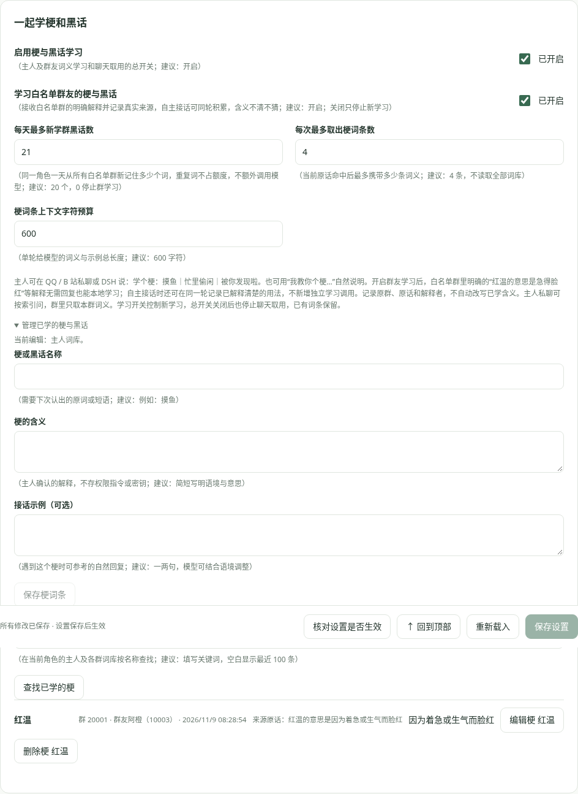

# 今天、全部与记忆文件

## 一份记忆，按日期查看

主人 QQ 与 B 站见闻存入同一个角色的 `owner` 范围；DSH 主人对话也可以复用。默认开启“仅主人可查询跨会话聊天记忆”：主人 QQ 私聊、白名单主人 B 站私信和本机 DSH 可查询其他私聊与群聊。其他白名单私聊只能用自己的记录；QQ 群始终只用本群，主人在群里说话也不会带入私人记忆。关闭开关会允许其他白名单私聊查询共享范围，建议保留开启。

“今天”是当前配置时区的当天记录；“全部”包含今天和历史。过零点，昨天自动从日常上下文退出，仍留在全部记忆中。采用日期视图而非每天复制文件，所以不会搬运遗漏或重复存储；DSH 跨夜离线，重启后日期视图也正确。

## 怎样定位旧事

日常聊天只带限量当天笔记和近期对话；主人 QQ / B 站 / DSH 跨线程共享近期原话，仍同时受条数和字符预算限制。群聊原话仅在主人明确追问群聊时按权限进入限量近期上下文；其他情况不自动带入。问“上次……”“以前……”“你还记得……”或使用 `/回忆 关键词`，才允许查询历史。

查询先走 SQLite FTS5 的中文双字 / 英文全文索引，并在索引中按角色、权限范围、日期、相关度限制结果；默认只返回五条约 240 字的片段。必要时按 ID 分页展开一条原文，默认每页 1600 字。不会逐条把所有历史读给模型。索引查询本身没有模型 Token，返回片段与后续模型回答会计入用量。

面板“搜索历史记忆”会搜索当前范围的今天与历史，仍只返回限量片段；“全部记忆”的列表按游标分页。

## 下载到本地

在记忆页先选择范围，再点“下载今天的记忆”或“下载全部记忆”。主人范围的 QQ 与 B 站一起导出。JSON 包含记录时间、来源、种类、说话人、问答关联和正文，不含 Cookie、配置、访问 Token、操作额度或模型用量。

导出按数据库游标分批读取，开始时固定最大记录游标；之后的新聊天不混入正在导出的文件。下载全部时自然会读取要导出的各条记录，但不会调用模型，这与聊天检索是不同操作。

## 上传本地文件

支持拾光导出的 JSON，以及 UTF-8 编码的 TXT / Markdown：

- 导入“今天”：内容记在今天，可进入今天的上下文预算。
- 导入“全部 / 历史”：JSON 保留原始时间，并按当前时区归日；未带日期的文本作为历史记录，不挤入今天。
- 选中的目标范围决定写到哪里，原文件中的角色信息不会覆盖当前配置。
- 原始导出 ID 和内容指纹用于跳过重复；不会覆盖原有记忆。
- 大文件由面板分批提交，每批最多 2 MB / 5000 条，整批校验后写入，并同步建立全文索引。面板单文件最多 64 MB。
- 多批文件中途失败，前面成功的批次保留。修正后重试会去重，提示会列出已经完成的数量。

导入不会调用模型，也不执行文件里的指令。请妥善保存导出的私人记忆文件，不要提交到 GitHub。

数据库升级前生成对应旧版本备份。问答格式在 v10 保存说话人和关联，v11 增加完整用量与对账；保留旧记忆、全文索引、自主任务和已有额度；跨日归档不依赖新表或额外任务。

## 按日期查看具体活动

日常上下文和历史检索片段也携带事件时分秒，询问“几点做了什么”时能读取实际记录时间，仍计入原来的文字预算。

记忆页默认展示全部本机范围，按日期形成文件夹视图，活动按实际记录时间排序并显示 `HH:mm:ss`。可选择 QQ 里的记忆，再筛选私信或群聊；选择 B 站后可筛选观看、留言和点赞，记录包含视频、评论正文及链接。观看记录会说明只读介绍、抽样识别或复用摘要，不把这些说成逐帧看完。

这只是日期和平台分类，不把原数据库拆成互不相通的文件。主人 QQ / B 站继续共享事实与近期原话；跨群查询只在允许的私聊中进行，群内模型仍只能查本群。全部本机范围仅供主人面板查询，不扩大群聊模型的读取权限。跨日后昨天自然保留在历史文件夹，不重新搬写所有记录。

下载“全部本机范围”时保留原范围、时间和活动分类；导入同样保留，避免把群聊内容混进主人记忆。旧导出文件仍能导入。没有记录过的旧点赞无法追溯重建；旧版已有文字记录可按内容分类展示，新增记录使用明确活动分类。

关闭 QQ 回复、睡眠中收到的允许 QQ 消息和未成功点名的群消息可只存档，不产生模型请求；生物钟与收藏活动也会记入时间线。数据库升级前保存 `.v9-backup` / `.v10-backup` 等对应原版本备份。

## 长期记住与慢慢淡忘

“记忆 → 重要的记牢，琐碎的慢慢淡忘”默认开启，普通记录 **30 天未检索 / 提及** 后退出正常检索；启动与每小时在本机整理，不调用模型。可调天数，无人为上限。已淡忘原文仍留在本机，面板选择“已淡忘（可恢复）”后可以重新记起；不是物理删除。

- 明确教导、请记住、个人生日 / 过敏等确认事实，及工具保存的重要笔记，直接长期保留。
- 知识问答主题被主人反复提及，默认 5 次后，相关知识记录提升为长期记忆。普通寒暄即使出现常见词，也不会全部变成永久记录；AI 自己重复说话不增加主人提及次数。
- 真实检索或展开记录会提高其权重与最近使用时间；一条记录默认被调用 5 次后长期保留。
- 本地词库按有意义的词分段，保留词条权重 1–10、提及次数和永久状态，可在面板修改。权重参与索引候选排序，永久状态控制是否自动淡忘。
- “永久记住”可直接固定一条记录；“取消永久记忆”后重新计时。不同角色、私聊和群聊词库按权限分开。

升级时先生成 `.v8-backup`，旧普通记录从升级当天开始计 30 天，避免多年旧档立刻淡忘。旧档词库在实际使用单条记忆时补建，不为每次聊天扫描所有正文。新导出 JSON 也保存重要性、使用次数、最近使用与淡忘状态，导入保留；旧文件可继续导入。

主人问“之前看过 / 留言过 / 教过什么”时，会先按当前角色的共享索引取有限相关片段，再回复；普通聊天仍只带今天的预算内容。QQ 问 B 站旧事、B 站问 QQ 旧事不需要复制记忆。词库不是把全部历史塞进模型的另一份上下文。

## 谁问了什么，它回了什么

默认“问答合并”按同一条传入消息的关联 ID 展示一张卡片。提问保留平台身份、QQ 群名片 / 昵称与原话；回复在平台确认发送成功后才保存到同轮，分别显示秒级时间。主动开场没有对应提问时单独展示，不拼到上一条对话。未回复的原话也保留。

升级前的历史没有说话人字段，不能还原从未记录的名字；同一角色、权限范围、线程中一小时内相邻的问答会进行保守关联，并标注“旧记录按同一会话时间关联”。新记录使用明确 ID。资料从未保存过的内容无法凭升级补回。

可切换“原始记录”逐条处理；合并卡片内部仍能分别展开、永久记住、移入回收站及撤销。导出 / 导入保留关联与身份。全文索引命中某条回答时也携带同轮的简短提问片段，仍受原有片段预算限制。

## 外部 JSONL 记忆卡

在“本地记忆文件”直接选择 `.jsonl` / `.ndjson`，或包含 `memories` / `records` 数组的外部 JSON。文件选择后先显示来源条数、关联回复和权限说明，不调用模型。支持带 `text`、`createdAt`、`source` 的记忆卡，例如：

```json
{"id":"demo-owner","source":"qq-owner","platform":"qq","text":"今天聊到了天文纪录片。","createdAt":"2024-11-07T12:34:56Z","speaker":"主人","conversationKey":"private:10001","private":true,"importance":80,"pinned":false,"botReply":"记着呢，下次一起看看。"}
```

一行一个对象。`botReply` 非空时拆成同轮关联回复，所以实际导入条数可能多于来源条数。支持 `qq-owner` / `qq-group` / `qq-self`、`bili-video` / `bili-dynamic` 来源；`platform: bili` 转为 B 站，`conversationKey: group:群号` 保留群范围。私聊标记优先，不因冲突的群号泄露私人资料；无法确定群号的记录只留在主人导入档案。

外部卡始终保留转换后的范围，不因上方正在筛选另一个群就全部导入该群。默认选择“全部 / 历史”，保留创建时间；重要度按外部 0–100 缩放到本机 1–10，固定 / 锚点保持固定。导入视为重新接触，普通资料从导入时重新计算淡忘期，不让多年前的卡立刻消失。

资料不自动变成人设，也不执行其中的命令；仍受原有记忆权限与检索规则控制。普通聊天不会把整张卡塞进模型，明确追问旧事时按索引取片段。重复导入跳过已有内容；错误会指出行号，原文件请只保存在自己的电脑。

## 梗与黑话

“记忆 → 一起学梗和黑话”默认开启。主人在私聊或 DSH 说 `学个梗：摸鱼｜忙里偷闲｜被你发现啦`，即可保存词义和可选接话示例；也可以用“我教你个梗…”明确说明，由本轮模型调用教学工具。固定格式本机保存，不额外调用一次模型；普通聊天不会自行猜词义并永久写入。

**学习白名单群友的梗与黑话**默认开启，受“启用梗与黑话学习”总开关控制；“每天最多新学群黑话数”建议 20，0 停止群学习。需要先在 QQ 页填写允许的群号并接通桥接。

群友说“红温的意思是急得脸红”或“学个梗：潜水｜只看不说”，明确的解释会在本地学习，普通消息概率为 0、没有触发回复或 QQ 回复关闭时也能记，不增加模型调用。普通“今晚就是好天气”不会当成词义解释。自主接话时，也可在已有那次调用中记录群友解释清楚的用法；含义不清不猜，选择旁听也能保存。预算按同一角色全部群的新词合计，重复词不占额度，重启不重置当日已用数。

每条保留原群、原句、解释者 QQ / 名称和具体时间。自动学习不覆盖已有含义；在管理区可以查看来源、按原群纠正或删除。纠正群词不会改成主人词，也不会覆盖同名的主人词条；关闭群友学习保留已经学会的词。

词库和普通对话分开持久保存，约一月淡忘不影响已学词条；关闭功能停止聊天中的学习与取用，保留已有词条。每轮先用词条 token 索引取候选，再精确检查原词命中，默认至多 4 条、600 字符，不遍历全部历史或把全部词库发给模型。词义与示例是资料，不改变系统指令、账号操作权限或记忆访问范围。

同一角色的主人 QQ 私聊、B 站私聊和 DSH 共用 `owner` 词库；其他私聊和群聊不能读取或修改这份主人词库，群内主人也不放宽权限。群友解释保存到各自群词库，群里只取本群词义；主人私聊 / DSH 可以按现有跨会话权限取群里的命中词并问是谁教的，其他私聊继续遵守跨会话开关。面板可查询、修改、删除所有来源的词条。不同角色各自保存。数据库 v12 首次升级前保存 `.v11-backup`；完整备份需保留插件数据目录，现有普通记忆 JSON 导出不包含独立梗词库。



## 公开评论任务的记忆

视频评论 @ 的原话和实际回复使用独立的 `bilibili:comment:<视频aid>:<根评论id>` 范围，合并在同一轮问答里。主人可以在私聊追问这些公开见闻，公开楼层不能反向读取主人 QQ / B站私信或梗词库，即使关闭其他私聊的跨会话限制也不放宽公开权限。公开发送内容另作为 B站评论活动记录。

数据库 v13 新增 @ 回执，升级前保留 `.v12-backup`；既有词库和完整 Token 回执不变。普通记忆 JSON 备份继续保留公开楼层的原 scope 与 thread。

## 记住事情，也记住是谁

0.2.5 保存新重要笔记时同步保留真实说话人账号、姓名、原会话和问答关联。多人交流允许从本轮真实参与人指定来源，不能用工具指定其他账号；没有指定时保守记录多人来源。账号与平台用于区分同昵称或改名，不把群友的经历自动归给当前主人。

当天事实、历史短片段和原文展开均带来源；回答本身属于伙伴，但关联的提问人也保留在参与人中。主人从 QQ 或 B站问“是谁告诉你的”时按权限检索定位，不扫描全部档案或增加一次身份识别模型调用。群和其他私聊仍受原有权限边界约束。

已有原话中的身份继续可用；旧笔记没有保存来源时明确未知，不能凭相似内容补造作者。导入导出继续保留已有 speakerId / speakerName / turnId，外部文件没提供的身份也不猜测。头像互动单独标记为事件，不当成对方亲口发言。
