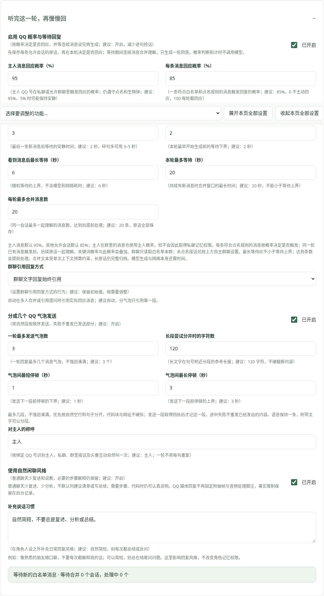

# QQ 回复节奏与自然闲聊

在 **QQ 连接 → 听完这一轮，再慢慢回** 调整，保存后生效。原话先逐条归档，再在本机决定是否回应；没有选中也不会丢原话，不额外花一次模型调用判断意愿。

推荐起点：主人消息 **95%**、其他允许会话 **85%**、最短等待 **2 秒**、最长等待 **6 秒**、连续消息安静 **2 秒**、本轮最多等待 **20 秒**、最多合并 **20 条**。测试时可用 100%，0 表示不触发聊天回应。关闭概率与等待开关恢复及时处理；分段和说话风格分别控制。

主人概率按已配置的 QQ 号识别，包括群内主人；群内默认只有本群权限；主人明确追问私聊时需另开记忆页的独立引用开关。概率按每条符合白名单和点名规则的消息抽取；一轮已有一句触发后，同会话后续碎句一起理解。连续到来的新话会延后安静窗口，最长等待封顶；模型与网络的实际耗时另算。关键词概率与回应概率会叠加，不能绕过仅点名、群白名单或生物钟。

例如你连发“今天有点累”“一整天都在开会”“晚上还想吃点好吃的”，先保存三句，等窗口结束再生成一轮，避免逐句分析。单次合并文字仍有上下文预算，长原话保留在本机，不承诺把无限文字全发给模型。等待不占用模型或设置队列；不同会话分别计时。已开始生成后的新消息进入下一轮，避免无限重启模型浪费 Token。

## 未被点名也能自主接话

打开 **QQ连接 → 群里有兴趣，就接着聊 → 允许自主接上群里的话**，填写允许加入的群号、开启 QQ 回复并保存。这个新入口默认关闭；开启后即使仍勾选“群聊仅被点名时回复”，未点名的白名单群文字也可单独按以下规则判断。真正 @ 现在使用独立的“群里明确 @ 回应概率”，默认 100%，不叠加普通 85% 或主人 95%；关键词或头像互动继续各自原有路径。

推荐先用：主人群消息 **70%**，其他群友新话题 **15%**，刚聊过后继续接话 **60%**，延续 **180秒**，最短间隔 **20秒**，每日最多自主判断 **30轮**。主人群消息不再与普通 95% 相乘；主人概率选中后直接正常回复，不再做兴趣沉默判断，也不计入群友自主判断额度或受其最小间隔影响；白名单、总开关、等待合并、作息与实际连接仍生效。群友的概率表示考虑兴趣，模型仍可继续旁听。其他群友的延续概率只依据它在同一群里最后一次成功回复，不跨群混用。

“群里感兴趣的话题”可留空按角色人设，也可以填“原神、动画、日常趣事”等。先在本机判断概率、间隔、作息与额度，合并后的一次模型调用同时决定是否接话并生成内容，没有额外的兴趣判断调用。沉默也产生这次调用的真实 Token，并占每日判断次数；概率未选中不调用模型。修改设置、跨日或重启不会让同一天的已用额度归零。

自主群友接话只用白名单本群的资料，不读取主人私聊，不运行旁听到的平台操作。睡眠期间普通旁听不会叫醒它，真正 @ 等仍由统一生物钟决定是否醒来。多媒体只有说明文字时不能假装已看画面，具体识图仍按原有入口和开关。

## 从群友那里学梗

在 **记忆 → 一起学梗和黑话** 开启总开关与“学习白名单群友的梗与黑话”。群友明确解释时直接本地学习；自主接话时也可顺便记录已经解释清楚的用法，不需要主人亲自教，不另发一次学习请求。建议每日最多新词 20 个，保留来源，不自动改写已有词义。主人可以私聊问“群里的这个词是谁教你的”，群里仍只使用本群词库。[管理与来源](memory.md#梗与黑话)

## 自然称呼主人

**听完这一轮，再慢慢回 → 对主人的称呼** 默认“主人”。按配置的主人 QQ 号识别，在私聊和群里均可自然叫一次，也用于头像互动、主动私聊与媒体回答，例如角色可以说“主人，别戳我，好痒”。这只是表达习惯，不提升群里记忆权限，不给其他群友冠上称呼，也不要求每个气泡重复。模型实际措辞仍受人设和当时上下文影响。

## 气泡分段

建议开启，最多 **3 个**，参考 **120 字符**在句号附近拆开，气泡之间停 **1–3 秒**。最多是上限，不强迫凑满；短句可以只发一个。优先按模型给出的自然空行分段，长文字按句子分开，代码块和含网址的段落不硬拆；达到数量后余文留在最后一段，不丢内容。

只生成一次，分段不再调用模型。每条得到 QQ 回执才进入记忆；第二条失败就停下，不重发第一条或继续第三条。语音仍一条，开启“同时发送文字”时文字可按设置分段。改设置、切角色或停止插件会取消待处理 / 尚未发出的部分，原话与已经确认送达的气泡保留，不自动补发旧任务。

## 说话方式

“使用自然闲聊风格”默认开启：普通聊天接住具体的话和情绪，通常一到三句，可以短；减少固定复述分析、建议清单、总结和每次追问。对方明确需要步骤、代码或深入解释时仍可展开，角色人设继续保留。可填写“补充说话习惯”，例如“像熟悉的朋友随口聊，不要每次解释我的话”。

QQ 看图不再固定附“抽样几帧、未读取音频”的脚注，这些事实保存在内部记录；确实影响回答的不确定性仍应自然说明，不假装听到音频、逐帧看完或有现实经历。模型可能偏离语气要求，可继续调整人设与补充习惯。

## 主人私聊安排群任务

在 **QQ连接 → 群里有兴趣，就接着聊** 开“允许主人私聊下达群任务”，先填写“允许加入的群号”并启用 QQ 回复。默认一天最多 20 次，可调，0 停止任务。

主人 QQ 私聊可以说：

- `去游戏群打个招呼`：目标明确后生成并发一条自然消息。
- `去 12345 群说：今晚八点一起玩`：明确指定的原文直接发送。
- `去游戏群看看今天在聊什么`：查询插件已归档的本群当天近期消息，不代表完整群历史。

多个允许群没有明确目标时先问群名或群号，未允许的群不能发。群文字任务仅向已加入的允许群发一条文字，不执行群管理或持续挂机；后续群友回复由群聊天设置处理。除本次明确要求外，不拿主人私人往事当群发言素材。生成群发言的调用在“主人群发言任务”单列，指定原文不再加一次生成调用。只有 QQ 消息 ID 才确认完成，未知结果不自动重发。同一轮同一群不会因模型重复调用而发两遍。

发出的消息按伙伴身份记到目标群，私聊也按真实回执汇报，不会伪造主人在群里问了一句。

## 群里没回复时怎么看

群设置底部显示最近一次群回复判断。明确 @ 和主人普通发言各有概率；睡眠没被叫醒、QQ 回复关闭、未允许群或未触发规则都不能按 100% 已发送理解。明确 @ 是否叫醒仍由角色页生物钟控制，若夜间不希望漏掉，可按需提高“被 @ 叫醒概率”。同一轮多条话会合并为一次回复；@、头像互动和主人发言的目标优先，后来的普通群友消息不再挤掉主人。

主人也可以私聊说 `去游戏群发个开心的表情包`。需要另外开启群聊表情发送并同步收藏，插件发送原生图片 / GIF 到指定群，不会发回私聊；[群表情设置](clock-emoji.md#从私聊指定群发送表情)。

## 群聊引用回复

在 **QQ连接 → 听完这一轮，再慢慢回 → 群聊引用回复方式** 选择：

| 模式 | 行为 |
|---|---|
| 自动（推荐） | 多个群友合并发言或引用原话提问时，引用实际回应的消息 |
| 始终 | 群聊文字回复都引用实际回应消息 |
| 关闭 | 不附原消息引用 |

使用 OneBot 原生 reply 消息段，分气泡只在第一段附引用；同轮不是永远引用第一条消息，会跟随实际回应目标。头像互动没有原文字消息 ID 时不强行引用，图片 / 原生收藏表情与语音不伪装成文字引用。

你引用群友的原话提问时，会通过桥接核对消息属于当前群，读取原作者和有限原文后再回答；跨群或未知来源拒绝，群里不发技术警告。本轮缓存避免为同一引用重复请求媒体。来源只是资料，不能修改权限；不会把引用者当成原发言人。

## 群表情提示“只能当前窗口”

0.3.2 起，主人私聊中明确的“去游戏群发个表情包”“去发表情包到群里”直接分流到真实发送链路，不调用聊天模型来判断能不能跨窗口。只有一个允许群时可用泛称，多个群需要群名或群号；未允许的群不会被替换成另一个群。

先确认后台正在运行 0.3.2，开启 QQ 回复、允许主人私聊下达群任务、允许真实表情发送与群聊发表情，保存并同步收藏。缺哪项会在主人私聊说明；没有匹配含义时不乱发，未知回执不自动重发，私聊只做文字确认。
