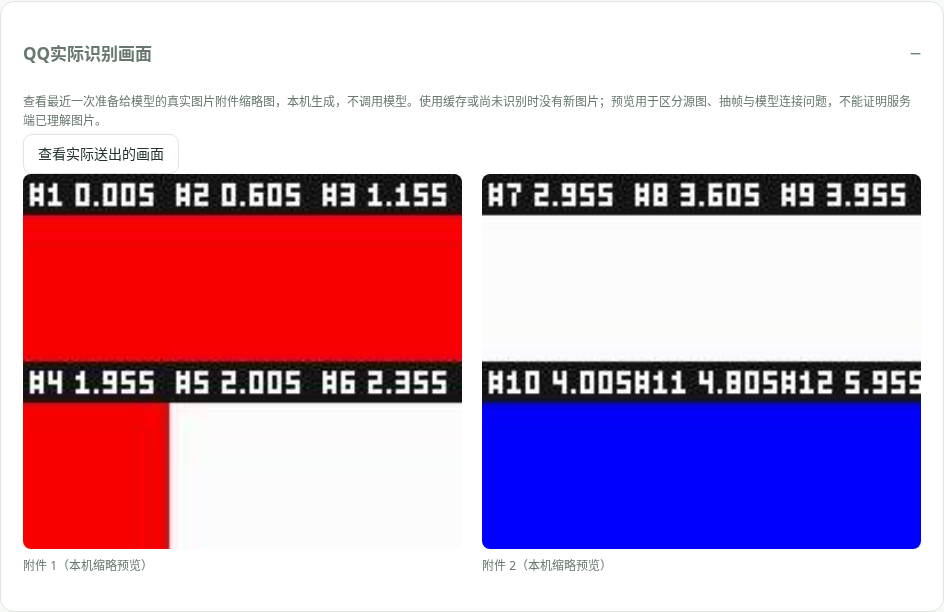

# QQ 图片、动画表情与视频

普通图片直接交给 DSH 图片附件服务；GIF / 动画 WebP 使用专门的动画解码，APNG 与视频使用随插件安装的内置视频核心。0.2.8 起无需下载、定位或填写本机 FFmpeg / FFprobe。QQ 识图默认关闭，B 站视频开关在 B 站页单独设置。

## 开启

1. 在 DSH 登录 DeepSeek 或配置官方 API，拾光统一使用支持图片的最新 Flash。
2. 一键启动 SnowLuma / QQ 并扫码，填写主人号、设置允许会话并保存。
3. 在 **QQ 连接 → QQ 识图** 开启识别并保存；默认按需模式。
4. 若普通图片已能识别，直接测试动画或视频。想单独检查本机解码，在 **内置动图与视频引擎** 点击检测；这一步不调用模型。

首次升级由 DSH 安装内置解码依赖，请等安装结束再重启 DSH 并刷新页面。旧路径字段保留配置兼容，当前版本不会使用这些路径。

## 先测模型再测QQ

- **测试模型能否看图**：内置红蓝图片直接请求当前 Flash，绕过 QQ 与媒体解码；产生一次模型调用，单列“图片识别自检”。正确读取颜色才算通过，不能保证所有图片和动画都能理解。
- **检测内置动图与视频引擎**：实际启动解码核心和图片库，不连接 QQ、不请求模型；确认安装依赖能在本机运行。
- 两项通过后，在 QQ 发普通图片，再发动画和短视频，附“看看”；也可引用同一会话的媒体消息说“看看”。默认按需模式不会自动处理所有媒体。
- 展开 **最近识图详情**：区分 QQ 下载、准备附件、动画画面 / 视频流、候选画面、提取与拼图、模型返回。普通图成功而动画失败，应查看实际解码阶段，不必反复更换模型。

[Flash 原生图片能力](https://api-docs.deepseek.com/guides/vision/)由 DSH 官方连接提供；短识图明确关闭思考，保留已有输出预算，不因输出格式再请求一次模型。

## 设置 120 帧却只报告 3 帧

**视频关键帧上限**只用于 QQ 视频；GIF / 动画 WebP / APNG 使用独立的**动图帧数上限**。例如视频 120、动图 50，则当前动图最多选择 50 帧。

关闭“动图动作过程优先”时，“差异筛选”会去掉相近画面。原文件有 120 帧但只有三种画面时，实际保留 3 帧是正常结果，不代表设置没保存。想保留更多动作过程，可将 **QQ 画面筛选方式**改为“均匀保留”并保存；原文件确实少帧时不能凭空增加，也不保证模型理解每个瞬间。

“控制每次识别的用量”显示**当前运行值**及**最近一次本机处理**：原文件帧数（能确认时）、候选数、筛选后保留数、适用上限和本机图片尺寸。这些统计来自解码器，不靠模型自行数格子。缓存命中显示原识别统计与“本次新抽取 0 帧”；更换帧数、尺寸或筛选模式会使用新的缓存键。帧数追问只读取同一会话近期的真实统计。

页底 **核对设置是否生效**比较落盘配置、当前设置和各服务运行引用，显示核对数量及不一致路径。它不读取全部私人聊天，不调用模型。未保存编辑需先保存；旧任务结果不会因新设置而重算。

拼图最长边 10240 是尺寸上限，不要求把低清 GIF 放大至 10240。新版不强制放大小原图，多帧按接近方形排布；面板显示的是本机准备图像尺寸，模型服务仍可能按自身规则缩放。输出 10000 Token 也是生成预算上限，不会要求它一定写满。

## 动作过程优先

**QQ连接 → 控制每次识别的用量 → 动图动作过程优先** 默认开启。GIF / 动画 WebP 在完整周期内保留前后时间锚点，参考局部动作变化挑帧，避免小物体的移动被大面积不变背景掩盖。保留数量仍不超过“动图帧数上限”；默认 8，想看动作细节可试 **12–16**。

多个画面可分到几张图片，每张画面按编号和时间排序，依次在同一次视觉调用里发送。“动图最多分图数”建议 **4**，“拼图最长边”建议 **768–1024**；实际图片不会强制放大小源图。分图能缓解大量画面挤成一张后小物体太小的问题，也可能提高输入 Token，服务可能再次缩放。

模型按准备、动作发生、最后结果核对人物和物体去向，摘要保留动作过程，后续只读取摘要时也有动作线索；没看清不能根据常识补剧情。缓存键已升级，旧摘要不会冒充新流程的结果。编号、时间来自本机选帧，仍是抽样，不能保证识别所有瞬间；本机生成样本验证不等于已正确识别用户原动图。

关闭动作优先时继续使用下方“QQ画面筛选方式”的差异 / 均匀模式，静态图片和普通视频不使用动图分图设置。视频预算独立，B站视频仍按原来的抽帧和分段处理。

## 动画如何读取

GIF 和动画 WebP 按真实帧和延迟读取一个完整周期，不循环到无限；保留变化的开始和结尾，默认按动作过程保留最多 8 帧；关闭动作优先后，可用差异或均匀模式。APNG 读取控制块里的帧延迟，再按实际周期取样。不是只把封面当成整段动画，也不把“所有帧已经解码”说成模型逐帧理解。

普通视频默认最多 3 张关键帧。普通视频拼成一张图，动图可分图，一次视觉调用生成短摘要与自然回答；模型实际看到的是选出的画面。非常短的一闪、细字或没选到的动作仍可能遗漏。可提高画面数 / 拼图尺寸，或单独截图提问。

一条消息含多个媒体时优先第一个视频，否则第一张图片；不会自动浏览其他未选媒体。群白名单、真正 @、关键词、生物钟和回应概率仍生效。

## 默认预算

| 项目 | 默认值 | 含义 |
|---|---:|---|
| 视频关键帧上限 | 3 | 仅用于 QQ 视频；差异 / 均匀均不超过上限 |
| 动图帧数上限 | 8 | 沿一个完整周期选择，独立于视频上限 |
| 画面筛选方式 | 差异 | 省用量；想看更多动作可选均匀 |
| 动图动作优先 / 分图数 | 开启 / 最多 4 张 | 按编号顺序共同进入一次模型调用 |
| 拼图最长边 | 512 px | 每张图含编号区域的尺寸上限 |
| 输出预算 | 320 Token，关闭思考 | 同一次调用返回摘要与自然回答 |
| 当天背景 | 600 字符 | 不读取全部历史 |
| 每日模型调用上限 | 30 | 未开启、未触发或额度不足不请求模型 |
| 摘要复用 | 24 小时 | 同角色、会话、内容与设置匹配才复用 |
| 下载 / 时长 | 20 MB / 120 秒 | 超过设置时停止，不假装看完 |

重复媒体仍需下载以核对内容哈希，命中摘要后不重新解码和传图，简短文字回答仍有一次模型用量。新解码缓存键与旧版分开。

## 升级清理旧工具

若找到拾光旧版 `media-tools/installed.json`，启动时先实际检测内置引擎；通过后只清理记录对应的便携工具目录、`ffmpeg.zip` 和下载断点。不会沿用户填写的 exe 路径删除文件，也不卸载系统 FFmpeg。

记录缺失、路径越界、链接或文件被占用时保留文件，结果显示在内置引擎区。根目录中的其他用户文件保留。清理失败不影响已经可用的新引擎。[依赖与许可证](third-party.md)

## 下载、记忆和用量

优先使用 SnowLuma `get_image` / `get_file` 刷新的 QQ 官方媒体地址；逐跳校验下载域名，不下载聊天文本中的任意 URL。若桥接仅返回本机文件，需填写同机的媒体缓存目录，真实路径必须位于其中；远程桥接的本地文件无法直接读取。

媒体源和临时目录处理后清理；DSH 图片附件沿用自身存储规则，不会自动清理 DSH 附件。SQLite 保存短摘要、真实来源人和同轮关联，私人缓存不会被带入其他群聊。

下载、解码、筛选、引擎检测、旧工具清理和读取当前时间都不产生模型 Token。图片、有限上下文和回答按服务回执计入 **QQ 视频 / 动图**；失败已返回的用量仍记录，缺失回执不猜测。像素和帧预算影响输入，JPEG 字节数不保证与费用等比例。

## 失败与边界

群里识图失败不发送配置、解码或模型警告；私聊短回应，后台保留阶段与诊断。模型返回兼容文字和常见 JSON 格式，真正空白或不完整回答不能算成功。

视频核心仍基于 FFmpeg WebAssembly 库，区别在于不再调用本机 exe、不接受用户工具版本的命令行参数；GIF / 动画 WebP 使用专门图片库。常见编码已用生成的真实文件验证，但不保证所有损坏文件、特殊编码或加密媒体均可读取。动画 / 视频解码尺寸限制为单边 4096 像素，处理有可取消的时间预算，失败不会偷偷改用收费视觉服务。

不进行原始音频转写、不承诺逐帧全片理解，也不将读取片段冒充看完完整视频。B 站 HTTP 412 是平台读取限制，发生在解码之前或其他平台请求阶段时应先处理平台验证；更换本机解码器不会解除它。

“使用省量预设”同时改为视频 3 帧、动图 8 帧、差异筛选、512 px；“使用清晰预设”同时改为视频 6 帧、动图 12 帧、均匀保留、768 px。它们同时调整输出和背景预算，应用后需要保存。两种预设不改变动作优先开关；动作分图也不为每帧额外请求模型。

表情识别同时区分动作和交流意思：画面描述保留动作链，另存可确认的情绪、梗意和适用场景；看不清时不强猜。新摘要带含义缓存，收藏时优先复用。发送按已学含义选择，也可在 QQ 页纠正旧收藏的标签。[含义与发送](clock-emoji.md#看懂表情的意思再按意思发送)

## 0.3.3：先确认实际看图链路

**QQ连接 → 执行链路与群任务实测** 显示当前运行的 QQ 回复、桥接、识图开关与处理阶段。“开启按需看图与表情反应”保留原预算，开启后请保存。媒体识别总开关同时管理普通图片、动图和视频。

- 按需模式下，普通图片可以先发，再在同一会话 30 分钟内说“看看这张图”；只取相同角色、登录 QQ、会话和发言人的最近媒体。引用另一条消息仍核对原会话，不随意取别人的图。
- “只发表情也自然接话”默认开启：单独发表情会先理解画面，再接情绪或动作。动作摘要和含义只供内部使用；明确问含义、过程或细节时才解释，不默认发一段表情说明书。
- 群友自主接话被选中时，图片也会进入视觉调用，并可在同一次调用选择继续旁听；群内识图失败不发技术警告。
- 问“我发的表情包是什么意思 / 看到了吗”是识图追问，不再误当作要求伙伴发送收藏表情。

**QQ实际识别画面 → 查看实际送出的画面** 本机生成真实附件的缩略预览，不产生模型调用。详情显示源文件字节数、准备的附件数量、模型路由、返回状态和失败环节。预览不等于模型已理解图片；缓存摘要没有新图片可预览。

如果预览有内容、模型却说未收到图片或全是空白，本次不缓存为成功、不记作已看懂、不自动收费重试。请运行“测试模型能否看图”检查当前 DSH Flash 连接；自检也失败时需要解决模型输入链路，继续更换同一表情不能证明已修复。源图确实近乎纯白或纯黑时，预览会如实显示。

