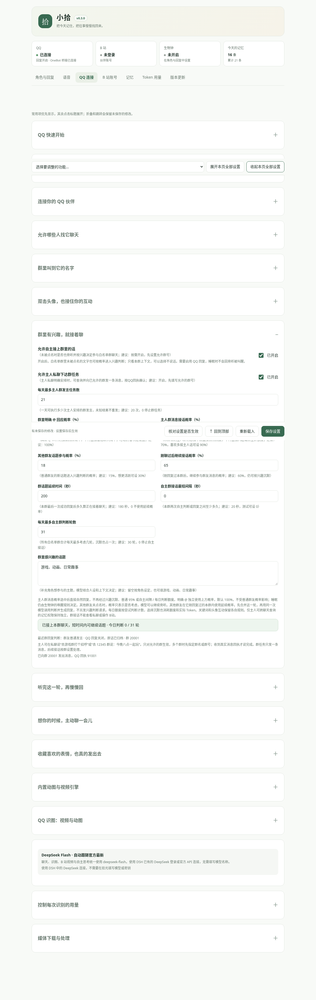

# 设置用途、推荐值与数值

所有可编辑控件旁都有括号提示，说明用途与推荐值。推荐值用于开始配置，不是固定上限；输入框与配置解析已移除旧的人为数值上限，也放开白名单数量、固定醒来时间数量和角色文字长度。

仍需满足基本数据格式：次数与字数使用整数，不能填负数，起止间隔顺序正确；标签 / 词条权重为 1–10，概率的定义是 0–100%，火山语音协议要求语速偏移在 -50–100。模型、平台、操作系统及机器资源自身的能力不会因为调高设置而改变。较大的视觉帧数、拼图、历史检索数量和输出预算也会增加时间、内存或实际模型费用。

| 场景 | 建议起点 |
|---|---|
| QQ 回应 | 85%，等 2–6 秒，安静窗口 2 秒，最多等 20 秒 / 合并 20 条 |
| QQ 气泡 | 最多 3 个，长段参考 120 字符，间隔 1–3 秒 |
| 日常记忆 | 当天笔记 2600 字符，近期 12 条 / 4000 字符，历史命中 5 条 / 每条 240 字符 |
| QQ 识图 | 3 帧、512 像素拼图、输出 320 Token、每天 30 次 |
| B 站浅看 | 4 帧、768 像素拼图、字幕 1800 字符、输出 480 Token |
| B 站深看 | 每段 90 秒，最多 8 段；每天识别 12 次，深看每段计一次 |
| 自主生活 | 每轮 2 个视频，每日 6 轮；输出 700 Token |
| 主动 QQ 私聊 | 适中档，间隔 60–240 分钟，每天最多思考 8 次 / 发送 4 次 |
| 表情收藏 | 每天收藏 3 个、挑选 8 次，输出 240 Token |
| 生物钟 | 08:00 起床、23:00 睡觉，@ 叫醒概率 25%，临时清醒 10 分钟 |
| 内置动图与视频引擎 | 随插件安装；检测不调用模型；升级验证后仅清理拾光旧安装记录对应的工具 |
| 检查与更新 | 检查 15 秒、下载 300 秒、失败重试 2 次 |

Token 是模型计量单位，不等于中文字数。输入中的人设、上下文、字幕与图片也可能计费；“输出 Token 上限”不是总消耗上限，推理模型的思考可能占输出预算。想限制聊天显示长度请使用“单次回复最多字数”。

设置保存后生效。平台的每日额度按角色时区计算，未知发送结果也占用尝试额度；把数值调大不会触发自动补发旧消息。基本整数表示能力与服务自己的限制仍适用，不能把任意大数当作无限资源。

布局将名称、输入框、括号说明分层，窄 DSH 面板自动改为单列，避免说明长度导致左右控件错位。概览按 QQ、B 站、生物钟、今天记忆排序，顶部展示当前版本，底部可一键回到顶部。

新增角色档案（各自记忆）、主人观看标签与白名单权重、普通记忆 30 天淡忘 / 知识 5 次提升等设置，详见 README 和记忆指南。生物钟是 QQ 与 B 站唯一作息入口。

回复节奏、自然风格与分段见 [QQ 回复](qq-conversation.md)；完整回执与实际金额区分、旧日志补齐见 [用量与对账](token-usage.md)。禁用按钮不显示等待光标；进行中的工作用文字状态表示。

“核对设置是否生效”检查已保存配置和当前运行服务；它不把未保存草稿当作已生效。后台工具安装 / 定位自动合并路径更新与独立草稿，保留视频数、QQ 白名单等编辑。同字段冲突会列出字段，需核对后重新载入；不会静默覆盖。

QQ 真实表情发送、自动收藏、聊天自动穿插是三个独立开关；推荐手动同步后先测试发送，自动穿插 15%、每天 20 个、间隔 15 秒。B站“尽量刷满每次视频上限”默认关闭，开启后候选足够才补足，识别权限和每日额度仍独立生效。

头像互动推荐 100% 回应、同一人 / 会话冷却 30 秒；与普通消息概率独立。睡眠是否允许被头像互动叫醒在角色页设置，默认关闭。B站受限请求冷却推荐 300 秒，调小不会解除平台限制；429 仍遵守服务要求。

角色页显示角色时区下的实时时分秒。每轮外部聊天、媒体回复和自主思考携带当前时间与真实睡醒状态；不会把旧聊天时间当成现在。旧 FFmpeg 路径字段只保留配置兼容，0.2.8 起不再使用或展示。

## 核对保存与实际选帧

页底核对工具逐项比较配置文件与运行设置，并检查各服务引用；显示字段与引用数量，不一致时列出路径。它验证保存和运行值，不表示每个上限都会用满。

QQ 的视频与动图帧数上限分开，默认差异筛选可能减少相近画面；均匀模式适合保留动作。当前运行值及最近调用实际候选 / 保留数、缓存和本机尺寸可在本页核对，详见 [帧数说明](qq-media.md#设置-120-帧却只报告-3-帧)。B站总分P时长上限已移到展开区域上方，600 秒即 10 分钟。

B站评论口吻位于“评论与互动”，默认像刷视频时围绕一个具体细节随手留一两句。可自由编辑或点击预设恢复；只影响自己撰写的评论和推荐，明确指定原文不改写。它不增加评论权限、次数或独立模型调用。

## 折叠与功能导航

0.3.0 起每页先显示常用区，其余功能按标题折叠。顶部“快速跳到功能”会展开目标及其父级并跳过去；“展开本页全部设置 / 收起本页全部设置”控制当前页面。输入仍保留在同一份草稿中，折叠不等于保存，修改后仍点击页底“保存设置”。错误旁的设置跳转也能打开折叠区。七个主分类不变，页底保留返回顶部和保存按钮。

