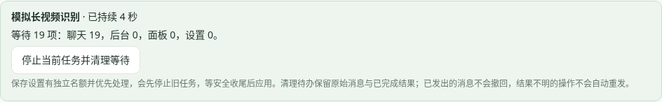

# 待处理队列与恢复

“待处理消息已满”表示插件同时处理或等待的任务达到配置容量；默认聊天和后台任务最多20项。旧版把部分后台检查、模型任务和设置操作排在同一个队列，长视频占用期间，未触发回复的表情候选甚至可能在关闭自动收藏时排入空任务，造成拥堵。

0.3.4 在进入队列前检查收藏开关、权限和额度，并把同时到达的候选合并为一项后台挑选。原始聊天仍逐条保存，不因候选合并而丢掉原话。

## 查看和停止

任务繁忙时，页面上方出现“待办任务状态”，显示当前任务名称、持续秒数、等待的聊天 / 后台 / 面板 / 设置数量。状态读取不排队，不调用模型。

点击“停止当前任务并清理等待”：

- 尚未开始的待办被取消，不在稍后暗中执行或发送。
- 当前任务收到停止请求，仍等待网络、模型或媒体处理安全退出后才释放串行锁，不通过重置计数并行跑旧操作。
- 原始消息、已完成结果和已确认回执保留；已发出的消息不撤回，发送结果不明的操作不自动重发。
- 只停止本轮，不关闭以后的自动调度；长期停用请关闭相应功能并保存。

## 保存设置

设置和面板操作有独立名额，保存优先于普通聊天和后台候选。有效设置提交后，先停止旧配置下正在进行的工作，安全收尾后保存并重建服务；旧配置待办会撤销，避免切换角色后执行到新的角色。无效设置或版本冲突不会提前打断当前工作。

当前操作若没有响应停止，状态会显示正在收尾，不能把尚在运行的任务当作已经结束。旧版遇到拥堵时，可先停止B站浏览、视频识别和旧收藏整理；仍无法恢复时退出并重启DSH，再更新插件。无需清空聊天数据库。

## 额度与用量

队列容量限制仍生效，避免无限积压；增加容量只允许更多任务等待。后台候选合并、状态读取、取消等待和计时不调用模型。已经开始的模型调用即使被停止，也可能产生服务商用量，仍按实际回执记录。
